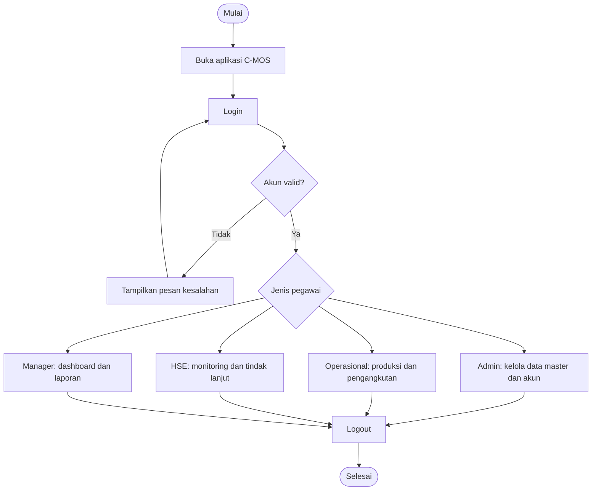
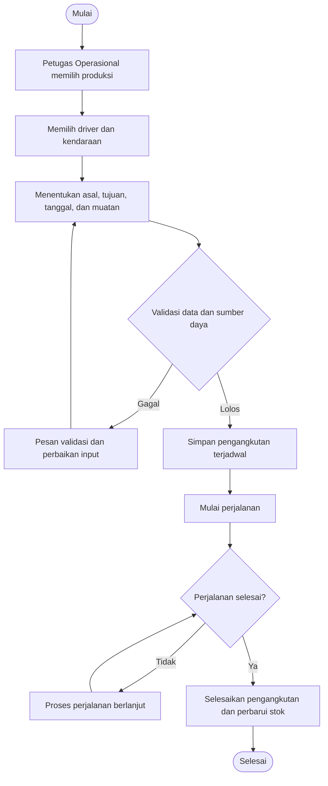
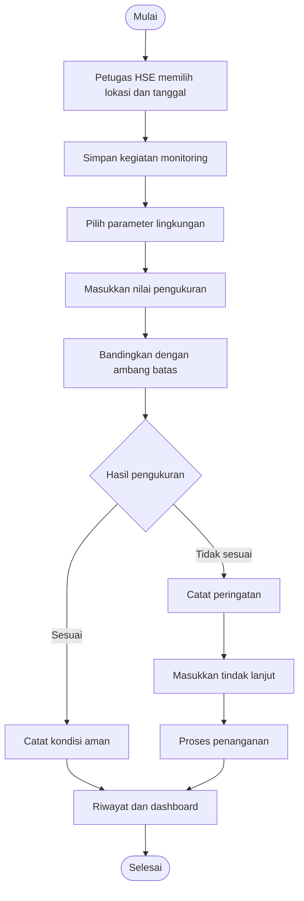
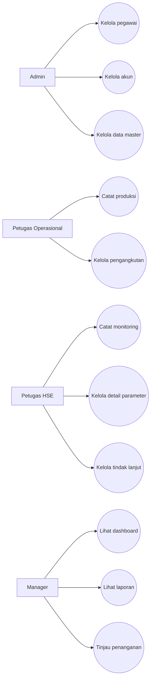

# C-MOS: Cobalt Mining Operation System

> Aplikasi desktop pengelolaan operasional pertambangan PT Cobalt.
>
> Proyek akademik Pemrograman Berorientasi Objek (PBO) dan Sistem Basis Data (SBD).

## Daftar Isi

1. [Nama Program](#1-nama-program)
2. [Deskripsi Singkat](#2-deskripsi-singkat)
3. [Fitur Utama Program](#3-fitur-utama-program)
4. [Tech Stack](#4-tech-stack)
5. [Perancangan Sistem](#5-perancangan-sistem)
6. [Struktur Folder dan Package](#6-struktur-folder-dan-package)
7. [Penerapan Empat Pilar OOP](#7-penerapan-empat-pilar-oop)
8. [Cara Penggunaan Program](#8-cara-penggunaan-program)
9. [Kontributor](#9-kontributor)

---

## 1. Nama Program

**C-MOS (Cobalt Mining Operation System)** adalah aplikasi desktop berbasis Java untuk mengelola kegiatan operasional PT Cobalt. C-MOS menghubungkan data pegawai, akun, lokasi, material, kendaraan, produksi, pengangkutan, pemantauan lingkungan, dan laporan manajemen.

- **Nama aplikasi:** Cobalt Mining Operation System (C-MOS)
- **Studi kasus:** PT Cobalt, perusahaan pertambangan fiktif untuk keperluan akademik.
- **Jenis aplikasi:** Desktop, multi-pengguna berdasarkan jabatan.
- **Proyek NetBeans/Maven:** `CobaltMiningOperationSystem`
- **Entry point:** `app.Main`
- **Fokus:** Produksi tambang, pengangkutan material, pemantauan lingkungan, dan dukungan keputusan manajer.

> **Gambar 1. Identitas dan tampilan awal aplikasi C-MOS**


**Arahan screenshot:** Jalankan aplikasi, ambil tampilan awal atau login yang menampilkan identitas C-MOS. Jangan memakai gambar desain contoh sebagai pengganti hasil program.

## 2. Deskripsi Singkat

PT Cobalt menjalankan aktivitas penambangan, pengangkutan hasil tambang, pengelolaan kendaraan dan driver, serta pemantauan lingkungan. Seluruh aktivitas tersebut menghasilkan data yang saling berhubungan. Pengelolaan terpisah menyulitkan pencarian informasi, pemeriksaan stok material, penjadwalan kendaraan, pemilihan driver, dan evaluasi kondisi lingkungan.

C-MOS dirancang untuk mengintegrasikan proses tersebut dalam satu aplikasi desktop yang terhubung ke MySQL. Petugas Operasional mencatat hasil produksi, lalu menggunakan produksi yang tersedia sebagai sumber pengangkutan. Sebelum membuat pengangkutan, sistem memeriksa kesesuaian lokasi, kapasitas kendaraan, ketersediaan driver, masa berlaku SIM, jumlah material, serta potensi benturan jadwal. Petugas HSE mencatat hasil pengukuran parameter lingkungan dan tindak lanjut. Manager memantau hasil kegiatan melalui dashboard dan laporan.

Data lingkungan menjadi informasi untuk pengambilan keputusan. Status peringatan lingkungan **tidak otomatis menghentikan pengangkutan**. Tindakan operasional tetap mengikuti kewenangan dan proses yang ditentukan perusahaan.

### 2.1 Tujuan pengembangan

1. Memusatkan pencatatan data operasional pertambangan.
2. Menghubungkan produksi dengan pengangkutan berdasarkan sumber material.
3. Mencegah penugasan driver atau kendaraan yang tidak memenuhi ketentuan operasional.
4. Mengontrol jumlah muatan terhadap kapasitas kendaraan dan stok produksi.
5. Mencatat hasil monitoring lingkungan dan tindak lanjutnya.
6. Menyediakan dashboard dan laporan untuk mendukung keputusan Manager.
7. Menerapkan konsep PBO, basis data relasional, dan antarmuka Java Swing.

### 2.2 Ruang lingkup

Sistem mengelola data pegawai, akun, lokasi, jenis material, kendaraan, parameter lingkungan, produksi tambang, pengangkutan, monitoring lingkungan, detail monitoring, dan laporan. Pemeriksaan teknis kendaraan secara terpisah tidak termasuk modul utama. Driver merupakan data pegawai yang ditugaskan dalam pengangkutan, bukan pengguna yang melakukan login.

### 2.3 Pembagian peran

| Peran | Tanggung jawab utama | Login |
| --- | --- | --- |
| Admin | Mengelola pegawai, akun, dan data master | Ya |
| Petugas Operasional | Mengelola produksi dan pengangkutan | Ya |
| Petugas HSE | Mengelola monitoring, pengukuran, dan tindak lanjut lingkungan | Ya |
| Manager | Melihat dashboard, laporan, detail operasional, dan informasi penanganan | Ya |
| Driver | Mengemudikan kendaraan pada kegiatan pengangkutan | Tidak |

**Catatan akses:** Manager tidak bertugas menambah detail pengukuran parameter. Pengisian pengukuran merupakan tanggung jawab Petugas HSE. Hak akses yang benar harus diuji pada hasil program.

## 3. Fitur Utama Program

### 3.1 Autentikasi dan pembagian akses

- Login menggunakan akun pengguna.
- Mengidentifikasi pegawai yang terhubung dengan akun.
- Mengarahkan pengguna ke halaman utama sesuai jenis pegawai.
- Menyediakan empat halaman utama: `MainFrameAdmin`, `MainFrameOperasional`, `MainFrameHSE`, dan `MainFrameManager`.
- Memisahkan data `User` dari `Pegawai`. Driver tidak memiliki akun login.

### 3.2 Pengelolaan pegawai

- Menambah, melihat, mengubah, dan menghapus data sesuai aturan sistem.
- Memilih jenis pegawai: Admin, Petugas Operasional, Petugas HSE, Manager, atau Driver.
- Menampilkan isian khusus sesuai jenis pegawai.
- Mengelola status kepegawaian.
- Menyimpan data turunan sesuai jenis pegawai pada tabel yang bersangkutan.

Contoh isian khusus: `shift_kerja` pada Petugas Operasional, `no_sim` dan `masa_berlaku_sim` pada Driver, `no_sertifikasi_HSE` pada Petugas HSE, serta `divisi_tanggung_jawab` pada Manager.

### 3.3 Pengelolaan akun pengguna

- Membuat dan mengelola akun bagi pegawai yang berhak login.
- Mengaitkan akun dengan satu pegawai.
- Memeriksa identitas saat login.
- Mengelola perubahan data akun sesuai hak akses.

### 3.4 Pengelolaan lokasi

- Menyimpan nama, jenis, status operasional, dan keterangan lokasi.
- Membedakan lokasi penambangan (`PIT`) dan lokasi penumpukan (`STOCKPILE`).
- Menyediakan pilihan lokasi pada produksi, pengangkutan, dan monitoring.

### 3.5 Pengelolaan jenis material

- Menyimpan nama material, satuan, dan deskripsi.
- Menghubungkan jenis material dengan catatan produksi.
- Menyediakan pilihan material dalam form produksi.

### 3.6 Pengelolaan kendaraan

- Menyimpan jenis kendaraan, nomor polisi, kapasitas, tahun, dan status kendaraan.
- Memeriksa ketersediaan kendaraan sebelum pengangkutan.
- Memvalidasi muatan agar tidak melampaui kapasitas.

### 3.7 Pengelolaan parameter lingkungan

- Menyimpan nama parameter, satuan, batas minimum, batas maksimum, dan keterangan.
- Menggunakan parameter sebagai acuan pemeriksaan hasil pengukuran.
- Menghubungkan parameter dengan setiap detail monitoring.

Contoh parameter yang dapat disiapkan dalam data master: pH air, TSS, PM10, kebisingan, dan kadar kobalt dalam air. Nilai batas harus mengikuti ketentuan atau data studi kasus yang digunakan, bukan angka asumsi tanpa dasar.

### 3.8 Produksi tambang

- Mencatat tanggal, lokasi, jenis material, jumlah produksi, dan petugas pencatat.
- Menghitung jumlah material yang tersedia untuk pengangkutan.
- Menyediakan daftar produksi sebagai sumber pengangkutan.
- Menampilkan status produksi dan informasi stok.

### 3.9 Pengangkutan material

- Memilih produksi sebagai sumber material.
- Memilih kendaraan dan driver yang tersedia.
- Menentukan lokasi asal dan tujuan.
- Memvalidasi muatan terhadap kapasitas kendaraan dan stok produksi.
- Memeriksa status pegawai, status driver, masa berlaku SIM, dan jadwal yang berpotensi bentrok.
- Mendukung tahapan pengangkutan: `DIJADWALKAN`, `DALAM_PERJALANAN`, `SELESAI`, dan pembatalan sesuai aturan program.
- Memperbarui stok setelah pengangkutan diselesaikan sesuai logika service.

### 3.10 Monitoring lingkungan

- Mencatat kegiatan monitoring berdasarkan lokasi dan petugas HSE.
- Memasukkan nilai hasil pengukuran untuk setiap parameter.
- Membandingkan hasil pengukuran dengan ambang batas.
- Menampilkan kondisi monitoring, tindak lanjut, dan status penanganan.
- Menyimpan riwayat monitoring serta detail pengukuran.
- Menyediakan informasi kondisi lokasi untuk Manager.

### 3.11 Dashboard dan laporan

- Dashboard khusus untuk setiap jenis pengguna.
- Ringkasan data produksi, pengangkutan, kendaraan, dan lingkungan sesuai kewenangan.
- Grafik ringkasan melalui komponen chart yang tersedia.
- Halaman laporan produksi, pengangkutan, dan monitoring.
- Penyajian data detail agar Manager dapat menilai kondisi operasional.

### 3.12 Pencarian, filter, dan validasi

Aplikasi menyediakan komponen tabel, form, dan filter pada berbagai halaman. Filter harus memuat data dari sumber yang relevan. Data internal seperti ID basis data dapat disembunyikan dari tampilan dan diganti nomor urut baris, tanpa menghilangkan ID yang dibutuhkan program untuk operasi CRUD.

## 4. Tech Stack

| Komponen | Teknologi | Penggunaan |
| --- | --- | --- |
| Bahasa | Java | Logika aplikasi, model, controller, dan antarmuka |
| GUI | Java Swing | JFrame, JPanel, JTable, JComboBox, JButton, dan komponen form |
| GUI Designer | Apache NetBeans GUI Builder | Mendesain dan memelihara antarmuka `.form` |
| Database | MySQL | Menyimpan data relasional |
| Akses database | JDBC | Koneksi dan eksekusi SQL |
| Driver database | MySQL Connector/J 8.3.0 | Penghubung JDBC ke MySQL |
| Build tool | Apache Maven | Dependensi dan build aplikasi |
| Layout | Swing Layout 1.0.3, AbsoluteLayout | Layout yang digunakan pada proyek |
| Pemilih tanggal | JCalendar 1.4 | Komponen tanggal pada form |
| Grafik | JFreeChart 1.5.4 | Grafik dashboard |
| Arsitektur | Model, View, Controller, Service, Repository, DAO | Pemisahan tanggung jawab program |

**Versi Java pada berkas yang diperiksa:** `pom.xml` berisi `<maven.compiler.release>26</maven.compiler.release>`. Oleh karena itu, README ini mengikuti konfigurasi proyek tersebut. Jika target tugas mewajibkan Java 8, konfigurasi dan kompatibilitas kode perlu disesuaikan terlebih dahulu.

**Konfigurasi database pada source:** `config.DatabaseConfig` menggunakan nilai bawaan `jdbc:mysql://localhost:3308/cmos_db`, pengguna `root`, dan kata sandi kosong jika variabel lingkungan tidak diisi. Nama database ini mengikuti source yang diperiksa, bukan asumsi dari diagram.

Variabel lingkungan yang didukung:

```text
CMOS_DB_URL
CMOS_DB_USER
CMOS_DB_PASSWORD
```

### 4.1 Cara menyiapkan proyek

1. Siapkan JDK sesuai versi `pom.xml`.
2. Instal Apache NetBeans yang mendukung proyek Maven dan versi Java tersebut.
3. Siapkan MySQL dan buat/import skema database yang sesuai dengan source proyek.
4. Pastikan alamat, port, nama database, username, dan password benar.
5. Buka folder `CobaltMiningOperationSystem` melalui NetBeans.
6. Jalankan proses pemuatan dependensi Maven.
7. Jalankan kelas utama `app.Main`.
8. Login menggunakan akun yang tersedia dalam database.

> **Gambar 2. Konfigurasi proyek Maven di NetBeans**


**Arahan screenshot:** Buka tab Projects, tampilkan nama proyek, Source Packages, Dependencies, dan file `pom.xml`.

> **Gambar 3. Koneksi database MySQL**


**Arahan screenshot:** Tampilkan daftar tabel database yang benar-benar digunakan. Jangan tampilkan kata sandi atau informasi sensitif.

## 5. Perancangan Sistem

### 5.1 Gambaran alur sistem

Alur utama aplikasi dimulai ketika pengguna membuka program dan login. Sistem memeriksa akun serta jenis pegawai. Setelah berhasil, aplikasi membuka halaman utama sesuai kewenangan pengguna. Setiap kegiatan operasional menggunakan data master yang sudah disimpan sebelumnya.



> **Gambar 4. Flowchart utama sistem C-MOS**


**Arahan gambar:** Buat flowchart final di draw.io, Lucidchart, atau aplikasi diagram lain berdasarkan alur di atas. Simpan hasil ekspor sebagai `images/04_Flowchart_Utama.png`.

### 5.2 Flowchart produksi dan pengangkutan



> **Gambar 5. Flowchart proses produksi dan pengangkutan**


**Arahan gambar:** Gambarkan validasi stok, kapasitas, driver, SIM, kendaraan, lokasi, dan jadwal. Tunjukkan pula jalur pembatalan sesuai aturan service.

### 5.3 Flowchart monitoring lingkungan



> **Gambar 6. Flowchart monitoring lingkungan**


**Arahan gambar:** Tampilkan kegiatan monitoring, pengisian detail parameter, hasil evaluasi, tindak lanjut, dan informasi kepada Manager.

### 5.4 Use case diagram



> **Gambar 7. Use case diagram C-MOS**


**Arahan gambar:** Gunakan aktor Admin, Petugas Operasional, Petugas HSE, dan Manager. Driver tidak perlu menjadi aktor login karena ia tidak mengakses aplikasi. Jika Driver digambar sebagai aktor bisnis, bedakan dari aktor pengguna sistem.

### 5.5 ERD dan struktur basis data

Perancangan basis data menggunakan `Pegawai` sebagai supertype dan lima subtype: `Admin`, `PetugasOperasional`, `PetugasHSE`, `Manager`, dan `Driver`. Tabel `User` menyimpan akun login yang terkait dengan pegawai. Produksi menjadi sumber pengangkutan. Monitoring lingkungan memiliki beberapa detail pengukuran, dan setiap detail merujuk pada satu parameter lingkungan.

> **Gambar 8. Entity Relationship Diagram C-MOS**


**Arahan gambar:** Gunakan screenshot ERD fisik dari MySQL Workbench yang memperlihatkan tabel, PK, FK, serta kardinalitas. Perbesar gambar sampai nama tabel dan atribut terbaca. Pastikan diagram sesuai database aktual yang dijalankan.

> **Gambar 9. Enhanced Entity Relationship Diagram dan subtype Pegawai**


**Arahan gambar:** Gunakan diagram konseptual yang menunjukkan pengelompokan lima subtype di dalam Pegawai, relasi dengan User, serta hubungan ke modul operasional dan monitoring.

#### 5.5.1 Kelompok entitas

| Kelompok | Entitas/tabel | Fungsi |
| --- | --- | --- |
| Kepegawaian | `pegawai` | Identitas dasar pegawai |
| Kepegawaian | `admin` | Atribut khusus Admin |
| Kepegawaian | `petugas_operasional` | Atribut khusus petugas operasional |
| Kepegawaian | `petugas_hse` | Atribut khusus HSE |
| Kepegawaian | `manager` | Atribut khusus Manager |
| Kepegawaian | `driver` | Data SIM dan ketersediaan driver |
| Akses | `user` | Kredensial akun |
| Master | `lokasi` | Lokasi tambang dan stockpile |
| Master | `jenis_material` | Klasifikasi material |
| Master | `kendaraan` | Armada pengangkutan |
| Master | `parameter_lingkungan` | Acuan pengukuran lingkungan |
| Operasional | `produksi_tambang` | Produksi dan material tersedia |
| Operasional | `pengangkutan` | Perjalanan pengangkutan |
| Lingkungan | `monitoring_lingkungan` | Kegiatan monitoring |
| Lingkungan | `detail_monitoring` | Nilai pengukuran per parameter |

#### 5.5.2 Relasi utama

1. `Pegawai` dengan `User`: satu pegawai dapat mempunyai nol atau satu akun.
2. `Pegawai` dengan subtype: setiap subtype memakai identitas pegawai sebagai dasar.
3. `PetugasOperasional` dengan `ProduksiTambang`: satu petugas dapat mencatat banyak produksi.
4. `PetugasOperasional` dengan `Pengangkutan`: satu petugas dapat mengelola banyak pengangkutan.
5. `JenisMaterial` dengan `ProduksiTambang`: satu jenis material digunakan pada banyak produksi.
6. `Lokasi` dengan `ProduksiTambang`: satu lokasi memiliki banyak catatan produksi.
7. `ProduksiTambang` dengan `Pengangkutan`: satu produksi dapat menjadi sumber banyak pengangkutan.
8. `Driver` dengan `Pengangkutan`: satu driver dapat mengemudikan banyak pengangkutan pada waktu berbeda.
9. `Kendaraan` dengan `Pengangkutan`: satu kendaraan dapat digunakan pada banyak perjalanan berbeda.
10. `Lokasi` dengan `Pengangkutan`: lokasi digunakan sebagai asal dan tujuan.
11. `PetugasHSE` dengan `MonitoringLingkungan`: satu petugas HSE dapat melakukan banyak monitoring.
12. `Lokasi` dengan `MonitoringLingkungan`: satu lokasi dapat dipantau berulang kali.
13. `MonitoringLingkungan` dengan `DetailMonitoring`: satu monitoring memiliki banyak hasil parameter.
14. `ParameterLingkungan` dengan `DetailMonitoring`: satu parameter dapat digunakan dalam banyak monitoring.

#### 5.5.3 Contoh keterkaitan data

Misalnya produksi di PIT A menghasilkan 120 ton material. Petugas membuat rencana pengangkutan sebesar 20 ton menggunakan kendaraan berkapasitas 25 ton. Sistem memeriksa bahwa produksi memiliki stok yang mencukupi, kendaraan tersedia, driver tersedia, SIM berlaku, dan lokasi tujuan sesuai. Setelah perjalanan selesai, sistem memperbarui stok produksi sesuai jumlah yang diangkut. Data ini kemudian masuk ke laporan pengangkutan dan ringkasan dashboard.

Pada waktu berbeda, HSE mengukur parameter lingkungan di PIT A. Jika salah satu nilai berada di luar ambang batas, hasil monitoring dapat menunjukkan peringatan. Manager melihat kondisi tersebut sebagai informasi untuk menentukan tindak lanjut, bukan sebagai pemblokiran otomatis oleh aplikasi.

### 5.6 Konsistensi model dengan database

Diagram yang digunakan pada README harus disamakan dengan skema MySQL yang benar-benar diimpor. Gambar konseptual dan fisik dapat memiliki perbedaan cara menampilkan subtype atau nama foreign key. Jangan mengubah penjelasan berdasarkan gambar saja tanpa memeriksa tabel database dan DAO. Pada source yang diperiksa, `jenis_kendaraan` merupakan atribut dalam `kendaraan`, bukan tabel master terpisah.

## 6. Struktur Folder dan Package

Struktur berikut mengikuti source Java pada arsip `CMOS_Revisi_Awal_GUIBuilder.zip` yang tersedia untuk pemeriksaan.

```text
CobaltMiningOperationSystem/
├── pom.xml
├── lib/
├── src/
│   └── main/
│       └── java/
│           ├── app/
│           │   └── Main.java
│           ├── config/
│           │   ├── AppConfig.java
│           │   └── DatabaseConfig.java
│           ├── controller/
│           │   ├── AuthController.java
│           │   ├── DashboardController.java
│           │   ├── LaporanController.java
│           │   ├── MasterDataController.java
│           │   ├── MonitoringController.java
│           │   ├── PengangkutanController.java
│           │   └── ProduksiController.java
│           ├── dao/
│           │   ├── JdbcSupport.java
│           │   ├── KendaraanDAO.java
│           │   ├── LokasiDAO.java
│           │   ├── MaterialDAO.java
│           │   ├── MonitoringDAO.java
│           │   ├── ParameterDAO.java
│           │   ├── PegawaiDAO.java
│           │   ├── PengangkutanDAO.java
│           │   ├── ProduksiDAO.java
│           │   └── UserDAO.java
│           ├── enums/
│           │   ├── JenisLokasi.java
│           │   ├── Periode.java
│           │   ├── ShiftKerja.java
│           │   ├── StatusDetail.java
│           │   ├── StatusDriver.java
│           │   ├── StatusKendaraan.java
│           │   ├── StatusLokasi.java
│           │   ├── StatusMonitoring.java
│           │   ├── StatusPegawai.java
│           │   ├── StatusPenanganan.java
│           │   ├── StatusPengangkutan.java
│           │   └── StatusProduksi.java
│           ├── exception/
│           │   ├── BusinessException.java
│           │   ├── DataNotFoundException.java
│           │   └── ValidationException.java
│           ├── model/
│           │   ├── Pegawai.java
│           │   ├── Admin.java
│           │   ├── PetugasOperasional.java
│           │   ├── PetugasHSE.java
│           │   ├── Manager.java
│           │   ├── Driver.java
│           │   ├── User.java
│           │   ├── Lokasi.java
│           │   ├── JenisMaterial.java
│           │   ├── Kendaraan.java
│           │   ├── ProduksiTambang.java
│           │   ├── Pengangkutan.java
│           │   ├── ParameterLingkungan.java
│           │   ├── MonitoringLingkungan.java
│           │   └── DetailMonitoring.java
│           ├── repository/
│           │   ├── CrudRepository.java
│           │   ├── PegawaiRepository.java
│           │   ├── UserRepository.java
│           │   ├── LokasiRepository.java
│           │   ├── MaterialRepository.java
│           │   ├── KendaraanRepository.java
│           │   ├── ProduksiRepository.java
│           │   ├── PengangkutanRepository.java
│           │   ├── ParameterRepository.java
│           │   └── MonitoringRepository.java
│           ├── service/
│           │   ├── AuthService.java
│           │   ├── MasterDataService.java
│           │   ├── ProduksiService.java
│           │   ├── PengangkutanService.java
│           │   ├── MonitoringService.java
│           │   ├── DashboardService.java
│           │   └── LaporanService.java
│           ├── util/
│           │   ├── BootstrapAdmin.java
│           │   └── PasswordUtil.java
│           └── view/
│               ├── LoginFrame.java
│               ├── MainFrameRouter.java
│               ├── MainFrameAdmin.java
│               ├── MainFrameOperasional.java
│               ├── MainFrameHSE.java
│               ├── MainFrameManager.java
│               ├── DashboardAdminPanel.java
│               ├── DashboardOperasionalPanel.java
│               ├── DashboardHSEPanel.java
│               ├── DashboardManagerPanel.java
│               ├── DashboardCharts.java
│               ├── PegawaiPanel.java
│               ├── PegawaiFormFrame.java
│               ├── UserPanel.java
│               ├── UserFormFrame.java
│               ├── LokasiPanel.java
│               ├── LokasiFormFrame.java
│               ├── MaterialPanel.java
│               ├── MaterialFormFrame.java
│               ├── KendaraanPanel.java
│               ├── KendaraanFormFrame.java
│               ├── ParameterPanel.java
│               ├── ParameterFormFrame.java
│               ├── ProduksiPanel.java
│               ├── ProduksiFormFrame.java
│               ├── PengangkutanPanel.java
│               ├── PengangkutanFormFrame.java
│               ├── MonitoringPanel.java
│               ├── MonitoringFormFrame.java
│               ├── DetailMonitoringFormFrame.java
│               ├── MonitoringDetailFrame.java
│               ├── KondisiLokasiPanel.java
│               ├── KartuLokasiPanel.java
│               ├── LaporanProduksiPanel.java
│               ├── LaporanPengangkutanPanel.java
│               ├── LaporanMonitoringPanel.java
│               ├── UbahAkunFrame.java
│               ├── DataScreen.java
│               ├── FormUtil.java
│               ├── PilihanData.java
│               └── ViewFactory.java
└── ...
```

> **Gambar 10. Struktur Source Packages di NetBeans**


**Arahan screenshot:** Perluas seluruh package pada panel Projects. Jika terlalu panjang, ambil beberapa screenshot dan gabungkan menjadi satu gambar yang tetap terbaca.

### 6.1 Package `app`

`Main.java` merupakan titik masuk aplikasi. Method `main()` memanggil `SwingUtilities.invokeLater()` agar antarmuka Swing dibuat pada Event Dispatch Thread. Setelah menginisialisasi konfigurasi aplikasi, program membuka `LoginFrame`.

### 6.2 Package `config`

- `AppConfig.java` menyiapkan komponen dan dependensi aplikasi.
- `DatabaseConfig.java` mengatur koneksi JDBC ke MySQL serta menyediakan pemeriksaan koneksi.

### 6.3 Package `controller`

Controller menghubungkan aksi pengguna dari tampilan dengan proses di service. `AuthController` menangani autentikasi, `MasterDataController` menangani data master, `ProduksiController` menangani produksi, `PengangkutanController` menangani pengangkutan, `MonitoringController` menangani monitoring, dan controller dashboard/laporan menyiapkan informasi untuk tampilan.

### 6.4 Package `dao`

DAO berisi implementasi akses database melalui JDBC. Setiap DAO berfokus pada kelompok data tertentu. Contohnya `ProduksiDAO` menangani penyimpanan dan pembacaan produksi, sedangkan `PengangkutanDAO` menangani data pengangkutan. `JdbcSupport` menyediakan fungsi pendukung operasi JDBC.

### 6.5 Package `enums`

Enum membatasi nilai status atau kategori ke pilihan yang telah ditentukan. Contohnya `StatusPengangkutan`, `StatusDriver`, `StatusKendaraan`, `StatusMonitoring`, dan `ShiftKerja`. Penggunaan enum mengurangi kesalahan penulisan status pada logika Java.

### 6.6 Package `exception`

- `ValidationException`: kesalahan nilai masukan.
- `DataNotFoundException`: data yang diminta tidak ditemukan.
- `BusinessException`: pelanggaran aturan proses bisnis.

### 6.7 Package `model`

Model merepresentasikan objek utama sistem. `Pegawai` merupakan superclass abstrak bagi lima jenis pegawai. Model lain merepresentasikan lokasi, material, kendaraan, produksi, pengangkutan, monitoring, parameter, dan detail monitoring.

### 6.8 Package `repository`

Repository mendefinisikan operasi data yang diperlukan oleh service. `CrudRepository` menyediakan kontrak operasi umum. Repository khusus memisahkan kebutuhan data per domain, sedangkan DAO menjalankan query JDBC yang sesuai.

### 6.9 Package `service`

Service menyimpan aturan bisnis. Contohnya `PengangkutanService` memeriksa kapasitas, ketersediaan, tanggal, SIM, stok, dan jadwal sebelum membuat pengangkutan. `MonitoringService` menangani kegiatan monitoring, detail pengukuran, dan tindak lanjut. `DashboardService` serta `LaporanService` menyajikan data ringkasan dan laporan.

### 6.10 Package `util`

`BootstrapAdmin` menyediakan proses pendukung inisialisasi admin, sedangkan `PasswordUtil` menyediakan fungsi pendukung pengelolaan kata sandi.

### 6.11 Package `view`

Package `view` menyimpan JFrame dan JPanel antarmuka. Berkas `.form` yang menyertai sejumlah kelas view merupakan metadata desain NetBeans GUI Builder. Desain komponen dan layout harus dikelola melalui tab **Design**, bukan dengan membuat panel visual baru secara manual melalui kode.

`MainFrameRouter` mengarahkan pengguna ke halaman utama berdasarkan jenis pegawai. Setiap `MainFrame...` menyediakan navigasi untuk peran terkait. `...Panel` menyajikan halaman daftar, dashboard, atau laporan. `...FormFrame` menyediakan formulir tambah dan ubah data.

> **Gambar 11. File `.java` dan `.form` pada GUI Builder**


**Arahan screenshot:** Pilih `PegawaiFormFrame` atau form lain di NetBeans. Tampilkan tab Design, Palette, Inspector, dan Properties.

## 7. Penerapan Empat Pilar OOP

### 7.1 Encapsulation

Encapsulation melindungi atribut objek dengan akses `private` dan menyediakan akses terkontrol melalui method. Contohnya pada `model.Pegawai`:

```java
private int idPegawai;
private String namaPegawai;
private String noHp;
private java.time.LocalDate tanggalMasuk;
private enums.StatusPegawai statusPegawai;

public String getNamaPegawai() {
    return namaPegawai;
}

public void setNamaPegawai(String value) {
    this.namaPegawai = value;
}
```

Atribut `namaPegawai` tidak diakses langsung oleh kelas lain. Kelas lain menggunakan getter atau setter. Dengan demikian, struktur data objek tetap terkendali. Validasi bisnis yang lebih kompleks ditempatkan pada service sebelum perubahan data disimpan.

> **Gambar 12. Bukti encapsulation pada `Pegawai.java`**


**Arahan screenshot:** Sorot deklarasi atribut `private` serta method getter dan setter dalam `model/Pegawai.java`.

### 7.2 Inheritance

Inheritance memungkinkan subclass mewarisi atribut dan method dari superclass. Dalam proyek ini, `Pegawai` merupakan superclass bagi `Admin`, `PetugasOperasional`, `PetugasHSE`, `Manager`, dan `Driver`.

```java
public abstract class Pegawai {
    // Atribut dasar pegawai dan method bersama.
}

public class Admin extends Pegawai {
    // Atribut khusus Admin.
}

public class Driver extends Pegawai {
    // Atribut khusus Driver.
}
```

Kode tersebut menunjukkan hubungan pewarisan yang terdapat pada source. Setiap subtype memiliki atribut bersama dari `Pegawai` serta atribut khusus sesuai tugasnya. Contohnya Driver mempunyai informasi SIM, sedangkan Petugas Operasional memiliki informasi shift kerja.

> **Gambar 13. Bukti inheritance pada subclass Pegawai**


**Arahan screenshot:** Buka `Pegawai.java`, `Admin.java`, dan `Driver.java`. Sorot deklarasi `extends Pegawai`. Sertakan diagram hierarki kelas jika memungkinkan.

### 7.3 Polymorphism

Polymorphism memungkinkan objek dari beberapa subclass diperlakukan sebagai tipe superclass yang sama, tetapi memberikan perilaku sesuai jenis objek. Dalam proyek, `Pegawai` mendefinisikan method abstrak `getJenisPegawai()` dan setiap subclass mengimplementasikannya.

```java
public abstract String getJenisPegawai();
```

Contoh pemakaian konsep:

```java
Pegawai pegawai = new Driver(/* parameter konstruktor sesuai model */);
String jenis = pegawai.getJenisPegawai();
```

Baris pemanggilan `getJenisPegawai()` menggunakan tipe referensi `Pegawai`, tetapi implementasi yang dijalankan berasal dari subclass objek aktual. Potongan kedua merupakan **ilustrasi konsep**, bukan salinan kode yang siap dikompilasi karena argumen konstruktor disingkat.

> **Gambar 14. Bukti polymorphism pada `getJenisPegawai()`**


**Arahan screenshot:** Tampilkan deklarasi method di `Pegawai.java` dan implementasi override pada minimal dua subclass, misalnya `Driver.java` dan `PetugasHSE.java`.

### 7.4 Abstraction

Abstraction menyajikan kontrak penting tanpa mewajibkan pemanggil mengetahui seluruh detail implementasi. `Pegawai` ditetapkan sebagai `abstract class`, sehingga objek `Pegawai` umum tidak dapat dibuat secara langsung. Subclass harus menyediakan implementasi `getJenisPegawai()`.

```java
public abstract class Pegawai {
    public abstract String getJenisPegawai();
}
```

Selain itu, `repository.CrudRepository` dan repository khusus menggunakan interface sebagai kontrak akses data. Service dapat bekerja terhadap operasi repository tanpa perlu mengetahui setiap detail SQL di DAO.

> **Gambar 15. Bukti abstraction pada abstract class**


**Arahan screenshot:** Sorot kata `abstract` pada deklarasi `Pegawai` dan method `getJenisPegawai()`.

> **Gambar 16. Bukti abstraction pada interface repository**


**Arahan screenshot:** Buka `repository/CrudRepository.java` dan salah satu repository khusus. Tampilkan kontrak method yang tersedia.

### 7.5 Keterkaitan OOP dengan arsitektur

Penerapan empat pilar OOP tidak berdiri sendiri. Model memanfaatkan encapsulation, inheritance, polymorphism, dan abstraction. Service menggunakan objek model serta kontrak repository untuk menjalankan aturan bisnis. Controller meneruskan permintaan dari view ke service. DAO berkomunikasi dengan database melalui JDBC. Pemisahan ini memudahkan pengujian dan perubahan logika tanpa mencampurkan seluruh proses ke dalam satu JFrame.

> **Gambar 17. Diagram alur arsitektur aplikasi**


**Arahan gambar:** Buat diagram `View → Controller → Service → Repository → DAO → MySQL`, dengan `Model` sebagai objek data yang digunakan antarlapisan. Sesuaikan arah panggilan dengan implementasi aktual.

## 8. Cara Penggunaan Program

Bagian ini merupakan panduan urutan penggunaan sekaligus daftar screenshot yang perlu dibuat. Nama menu, tombol, dan ketersediaan aksi harus dicocokkan dengan hasil aplikasi yang dijalankan. Gambar yang belum tersedia tidak dianggap sebagai bukti pengujian.

### 8.1 Persiapan sebelum menjalankan aplikasi

Pastikan MySQL aktif, database tersedia, tabel telah dibuat, dan akun awal tersedia. Periksa konfigurasi koneksi pada `DatabaseConfig.java`. Buka proyek melalui NetBeans, tunggu dependensi Maven selesai, lalu jalankan `app.Main`.

> **Gambar 18. Menjalankan `app.Main` di NetBeans**


**Arahan screenshot:** Tampilkan `app/Main.java` dan proses Run Project di NetBeans.

### 8.2 Tampilan awal dan login

Saat program berjalan, `Main.java` menginisialisasi aplikasi dan membuka `LoginFrame`. Pengguna memasukkan username serta password. Jika autentikasi gagal, aplikasi menampilkan pesan kesalahan. Jika berhasil, aplikasi membuka MainFrame sesuai jenis pegawai.

> **Gambar 19. Halaman login C-MOS**


**Arahan screenshot:** Ambil keseluruhan jendela login sebelum mengisi kredensial.

> **Gambar 20. Validasi login**


**Arahan screenshot:** Masukkan data login yang salah untuk menampilkan pesan validasi. Jangan tampilkan password akun asli.

### 8.3 Dashboard Admin

Login menggunakan akun Admin. Halaman utama menampilkan navigasi dan ringkasan sesuai hak akses. Admin menyiapkan data master yang dibutuhkan modul operasional.

> **Gambar 21. Dashboard Admin**


**Arahan screenshot:** Tampilkan seluruh dashboard, sidebar, dan informasi ringkas.

### 8.4 Mengelola data pegawai

Buka menu Pegawai. Periksa tabel, pencarian, dan filter. Klik tombol tambah untuk membuka form pegawai. Isi identitas umum, pilih jenis pegawai, lalu lengkapi atribut khusus yang muncul. Simpan data dan pastikan tabel memperlihatkan pegawai baru. Uji tombol Ubah dan Batal.

> **Gambar 22. Halaman daftar pegawai**


**Arahan screenshot:** Tampilkan tabel pegawai dan kontrol pencarian/filter.

> **Gambar 23. Form tambah pegawai**


**Arahan screenshot:** Tampilkan form sebelum memilih jenis pegawai. Pastikan tidak ada label khusus subtype yang muncul secara tidak tepat.

> **Gambar 24. Form pegawai jenis Petugas Operasional**


**Arahan screenshot:** Pilih Petugas Operasional dan tampilkan isian `shift_kerja`.

> **Gambar 25. Form pegawai jenis Driver**


**Arahan screenshot:** Pilih Driver dan tampilkan `no_sim`, `masa_berlaku_sim`, dan `status_driver`.

> **Gambar 26. Form ubah pegawai**


**Arahan screenshot:** Pilih data pegawai yang sudah ada, klik Ubah, dan tampilkan isian yang terisi otomatis.

### 8.5 Mengelola akun pengguna

Buka menu User/Akun. Buat akun untuk pegawai yang memiliki hak login. Pilih pegawai yang sesuai, isi username dan kredensial, kemudian simpan. Periksa perubahan pada tabel. Pastikan Driver tidak diberikan akses login.

> **Gambar 27. Daftar akun pengguna**


**Arahan screenshot:** Tampilkan daftar akun dan kontrol pengelolaannya.

> **Gambar 28. Form tambah atau ubah akun**


**Arahan screenshot:** Tampilkan pilihan pegawai dan isian akun tanpa memperlihatkan kata sandi.

### 8.6 Mengelola lokasi tambang

Buka menu Lokasi. Tambahkan lokasi PIT dan STOCKPILE sesuai kebutuhan studi kasus. Lengkapi nama, jenis, status operasional, dan keterangan. Data lokasi akan digunakan saat membuat produksi, pengangkutan, dan monitoring.

> **Gambar 29. Halaman data lokasi**


**Arahan screenshot:** Tampilkan daftar lokasi dan filter jenis/status.

> **Gambar 30. Form lokasi**


**Arahan screenshot:** Tampilkan pengisian contoh lokasi PIT atau STOCKPILE.

### 8.7 Mengelola jenis material

Buka menu Material. Tambahkan jenis material yang digunakan perusahaan, isi satuan dan deskripsi, kemudian simpan. Periksa bahwa jenis material dapat dipilih pada form produksi.

> **Gambar 31. Halaman jenis material**


**Arahan screenshot:** Tampilkan tabel material.

> **Gambar 32. Form jenis material**


**Arahan screenshot:** Tampilkan pengisian nama material, satuan, dan deskripsi.

### 8.8 Mengelola kendaraan

Buka menu Kendaraan. Tambahkan data kendaraan, nomor polisi, jenis, kapasitas, tahun, dan status. Kendaraan yang tersedia dapat dipilih untuk pengangkutan selama memenuhi aturan sistem.

> **Gambar 33. Halaman kendaraan**


**Arahan screenshot:** Tampilkan daftar kendaraan beserta status dan kapasitas.

> **Gambar 34. Form kendaraan**


**Arahan screenshot:** Tampilkan form dengan contoh data kendaraan yang valid.

### 8.9 Mengelola parameter lingkungan

Buka menu Parameter Lingkungan. Tambahkan parameter beserta satuan dan batas pengukurannya. Data ini akan menjadi pilihan ketika Petugas HSE mencatat detail monitoring.

> **Gambar 35. Halaman parameter lingkungan**


**Arahan screenshot:** Tampilkan tabel parameter dan batas minimum/maksimum.

> **Gambar 36. Form parameter lingkungan**


**Arahan screenshot:** Tampilkan form pengisian parameter. Gunakan nilai ambang yang sesuai data studi kasus.

### 8.10 Dashboard Petugas Operasional

Logout dari Admin, kemudian login sebagai Petugas Operasional. Halaman ini menyediakan akses ke proses produksi dan pengangkutan, serta data yang diperlukan untuk memilih sumber daya operasional.

> **Gambar 37. Dashboard Petugas Operasional**


**Arahan screenshot:** Tampilkan halaman utama setelah login sebagai Petugas Operasional.

### 8.11 Mencatat produksi tambang

Buka menu Produksi. Klik Tambah, pilih tanggal, lokasi PIT, dan jenis material. Masukkan jumlah produksi serta informasi lain yang diminta. Simpan, lalu periksa bahwa data masuk ke tabel produksi dan jumlah tersedia tercatat.

> **Gambar 38. Halaman produksi tambang**


**Arahan screenshot:** Tampilkan daftar produksi dan informasi stok tersedia.

> **Gambar 39. Form tambah produksi**


**Arahan screenshot:** Tampilkan ComboBox lokasi dan material yang telah terisi data master.

> **Gambar 40. Hasil penyimpanan produksi**


**Arahan screenshot:** Tampilkan data produksi baru pada tabel setelah proses simpan.

### 8.12 Membuat pengangkutan

Buka menu Pengangkutan. Klik Tambah dan pilih produksi yang memiliki stok. Pilih driver, kendaraan, tanggal, lokasi asal, lokasi tujuan, dan jumlah muatan. Sistem memvalidasi ketersediaan sumber daya serta batas muatan. Jika lolos, pengangkutan disimpan dalam status terjadwal.

> **Gambar 41. Halaman pengangkutan**


**Arahan screenshot:** Tampilkan tabel pengangkutan dan status perjalanan.

> **Gambar 42. Form tambah pengangkutan**


**Arahan screenshot:** Tampilkan pilihan produksi, driver, kendaraan, asal, tujuan, dan muatan.

> **Gambar 43. Validasi kapasitas kendaraan**


**Arahan screenshot:** Coba isi muatan melebihi kapasitas kendaraan, lalu tampilkan pesan validasi.

> **Gambar 44. Validasi stok produksi**


**Arahan screenshot:** Coba isi muatan melebihi stok yang tersedia, lalu tampilkan pesan validasi.

### 8.13 Memulai dan menyelesaikan pengangkutan

Pilih pengangkutan yang telah dijadwalkan. Jalankan aksi mulai sesuai tombol pada halaman. Setelah perjalanan selesai, jalankan aksi selesai. Periksa perubahan status dan perubahan jumlah material tersedia. Jika perjalanan dibatalkan, periksa apakah status dan reservasi sumber daya diperbarui sesuai aturan bisnis.

> **Gambar 45. Pengangkutan dalam perjalanan**


**Arahan screenshot:** Tampilkan status perjalanan setelah aksi mulai.

> **Gambar 46. Pengangkutan selesai**


**Arahan screenshot:** Tampilkan status selesai dan waktu perjalanan jika tersedia.

> **Gambar 47. Perubahan stok produksi**


**Arahan screenshot:** Bandingkan stok sebelum dan setelah pengangkutan selesai. Gunakan angka nyata dari hasil pengujian.

### 8.14 Dashboard Petugas HSE

Logout dan login sebagai Petugas HSE. Buka dashboard untuk melihat ringkasan monitoring dan kondisi lokasi yang dipantau.

> **Gambar 48. Dashboard Petugas HSE**


**Arahan screenshot:** Tampilkan halaman utama HSE.

### 8.15 Melihat kondisi lokasi

Buka halaman Kondisi Lokasi. Pilih lokasi yang ingin dipantau. Periksa status lingkungan, data monitoring terakhir, serta informasi detail yang tersedia.

> **Gambar 49. Kondisi lingkungan per lokasi**


**Arahan screenshot:** Tampilkan pilihan lokasi dan kartu/status lingkungan.

### 8.16 Membuat monitoring lingkungan

Klik aksi tambah monitoring, pilih lokasi dan tanggal, isi catatan, lalu simpan. Sistem mengaitkan monitoring dengan Petugas HSE yang sedang login.

> **Gambar 50. Form monitoring lingkungan**


**Arahan screenshot:** Tampilkan pemilihan tanggal menggunakan komponen kalender dan lokasi monitoring.

### 8.17 Mengisi detail parameter monitoring

Pilih monitoring yang telah dibuat. Tambahkan detail pengukuran dengan memilih parameter, memasukkan nilai, dan catatan. Simpan setiap hasil pengukuran. Periksa status hasil berdasarkan batas parameter.

> **Gambar 51. Halaman detail monitoring**


**Arahan screenshot:** Tampilkan daftar parameter dan hasil pengukuran dalam satu kegiatan monitoring.

> **Gambar 52. Form tambah detail parameter**


**Arahan screenshot:** Tampilkan ComboBox parameter dan isian nilai ukur.

> **Gambar 53. Hasil monitoring dengan peringatan**


**Arahan screenshot:** Gunakan contoh nilai pengukuran yang menghasilkan status peringatan sesuai konfigurasi parameter.

### 8.18 Mencatat tindak lanjut dan penanganan

Untuk monitoring yang memerlukan perhatian, Petugas HSE mengisi tindak lanjut. Proses penanganan dapat dimulai, diperbarui, diselesaikan, atau diinformasikan kepada Manager sesuai aksi yang tersedia pada program. Periksa perubahan status setelah setiap aksi.

> **Gambar 54. Tindak lanjut monitoring**


**Arahan screenshot:** Tampilkan isian tindak lanjut serta status penanganan.

> **Gambar 55. Informasi monitoring kepada Manager**


**Arahan screenshot:** Tampilkan hasil aksi informasi/penanganan yang dapat dibaca Manager.

### 8.19 Melihat riwayat monitoring

Buka halaman riwayat monitoring. Gunakan filter lokasi atau periode jika tersedia. Pilih satu riwayat untuk melihat detail pengukuran dan catatan penanganan.

> **Gambar 56. Riwayat monitoring lingkungan**


**Arahan screenshot:** Tampilkan daftar riwayat dan filter yang terisi data.

### 8.20 Dashboard Manager

Logout dan login sebagai Manager. Dashboard menampilkan ringkasan produksi, pengangkutan, serta kondisi lingkungan. Manager menggunakan angka dan grafik untuk mengevaluasi kegiatan operasional. Manager tidak menambah detail pengukuran lingkungan.

> **Gambar 57. Dashboard Manager**


**Arahan screenshot:** Tampilkan seluruh kartu ringkasan dan grafik dashboard Manager.

### 8.21 Laporan produksi

Buka Laporan Produksi. Periksa total produksi, data lokasi, material, dan periode. Gunakan filter yang tersedia untuk melihat data yang dibutuhkan.

> **Gambar 58. Laporan produksi**


**Arahan screenshot:** Tampilkan ringkasan angka dan tabel laporan produksi.

### 8.22 Laporan pengangkutan

Buka Laporan Pengangkutan. Periksa data perjalanan, jumlah muatan, kendaraan, driver, dan status pengangkutan.

> **Gambar 59. Laporan pengangkutan**


**Arahan screenshot:** Tampilkan tabel dan ringkasan pengangkutan sesuai periode.

### 8.23 Laporan monitoring lingkungan

Buka Laporan Monitoring. Periksa kondisi lokasi, hasil pengukuran, status monitoring, dan tindak lanjut. Gunakan detail untuk meninjau informasi yang diperlukan dalam pengambilan keputusan.

> **Gambar 60. Laporan monitoring lingkungan**


**Arahan screenshot:** Tampilkan ringkasan monitoring, kondisi peringatan, dan detail hasil parameter.

### 8.24 Melihat detail penanganan sebagai Manager

Pilih monitoring yang membutuhkan perhatian. Baca nilai pengukuran, kondisi lokasi, tindak lanjut, dan status penanganan. Manager dapat meninjau informasi tersebut sesuai kewenangan yang diberikan, tetapi tidak mengisi nilai ukur baru sebagai Petugas HSE.

> **Gambar 61. Detail monitoring dalam mode Manager**


**Arahan screenshot:** Tampilkan halaman detail yang tidak menyediakan tombol tambah atau ubah nilai parameter bagi Manager.

### 8.25 Mengubah akun dan logout

Gunakan menu akun untuk mengubah informasi yang diizinkan. Setelah selesai, klik Logout untuk keluar dari sesi dan kembali ke halaman login.

> **Gambar 62. Form ubah akun**


**Arahan screenshot:** Tampilkan form perubahan akun tanpa memperlihatkan kredensial.

> **Gambar 63. Logout dan kembali ke login**


**Arahan screenshot:** Tampilkan halaman login setelah logout.

### 8.26 Pengujian fungsional yang perlu didokumentasikan

| No. | Skenario pengujian | Hasil yang diharapkan | Bukti |
| --- | --- | --- | --- |
| 1 | Login dengan akun benar | Dashboard sesuai peran | Gambar 19 dan 21/37/48/57 |
| 2 | Login dengan akun salah | Pesan kesalahan | Gambar 20 |
| 3 | Memilih subtype pegawai | Isian khusus muncul sesuai subtype | Gambar 24–25 |
| 4 | Menekan Batal pada form | Form ditutup atau perubahan dibatalkan sesuai desain | Screenshot tambahan |
| 5 | Menambah lokasi/material | Data tersedia pada ComboBox modul lain | Gambar 30, 32, 39 |
| 6 | Menambah produksi | Produksi tersimpan dan stok awal tersedia | Gambar 39–40 |
| 7 | Muatan melebihi kapasitas | Sistem menolak | Gambar 43 |
| 8 | Muatan melebihi stok | Sistem menolak | Gambar 44 |
| 9 | Driver tidak tersedia atau SIM kedaluwarsa | Sistem menolak penugasan | Screenshot tambahan |
| 10 | Kendaraan atau driver bentrok | Sistem menolak jadwal sesuai aturan | Screenshot tambahan |
| 11 | Menyelesaikan pengangkutan | Status dan stok diperbarui | Gambar 46–47 |
| 12 | Menambah detail monitoring | Nilai dan status tersimpan | Gambar 51–53 |
| 13 | Tindak lanjut monitoring | Status penanganan berubah | Gambar 54–55 |
| 14 | Manager membuka detail monitoring | Data dapat dilihat tanpa aksi pengukuran HSE | Gambar 61 |
| 15 | Filter tabel | Hasil sesuai pilihan filter | Screenshot tambahan |
| 16 | Nomor urut tabel | Tabel menampilkan nomor baris, bukan ID internal | Screenshot tambahan |
| 17 | Konsistensi ukuran halaman | MainFrame dan panel tampil rapi | Screenshot empat dashboard |

**Penting:** Tabel di atas merupakan **rencana pengujian**, bukan klaim bahwa semua skenario sudah lulus. Isi hasil pengujian berdasarkan eksekusi aplikasi dengan database yang aktif.

### 8.27 Ketentuan dokumentasi GUI Builder

1. Gunakan hasil screenshot aplikasi yang benar-benar dijalankan.
2. Simpan semua gambar pada folder `images/` di lokasi yang sama dengan README.
3. Gunakan nama file yang persis sesuai referensi gambar di atas.
4. Tampilkan keseluruhan form atau halaman, bukan potongan kecil yang kehilangan konteks.
5. Untuk bukti desain, tampilkan tab Design di NetBeans dan berkas `.form`.
6. Jika halaman menggunakan ukuran utama 1400 × 800, pastikan screenshot memperlihatkan tata letak yang konsisten.
7. Hindari menampilkan password, data pribadi, atau konfigurasi rahasia.
8. Jika terdapat halaman loading atau landing pada versi final yang berbeda dari arsip yang diperiksa, tambahkan screenshot dan penjelasan sebelum Gambar 19. Jangan mengklaim fitur tersebut tersedia hanya berdasarkan rancangan.

## 9. Kontributor

Proyek C-MOS dikembangkan sebagai tugas kelompok. Isi nama dan NIM seluruh anggota sesuai identitas tim yang benar.

| No. | Nama | NIM | Peran |
| --- | --- | --- | --- |
| 1 | Zefri Al Rizqullah | 2509116084 | Anggota tim |
| 2 | **[Nama anggota 2]** | **[NIM anggota 2]** | Anggota tim |
| 3 | **[Nama anggota 3]** | **[NIM anggota 3]** | Anggota tim |
| 4 | **[Nama anggota 4, jika ada]** | **[NIM anggota 4]** | Anggota tim |

> **Gambar 64. Dokumentasi tim pengembang, opsional**


**Arahan gambar:** Tambahkan dokumentasi tim atau identitas kelompok jika diminta dosen. Hapus baris anggota yang tidak digunakan.

---

## Lampiran A. Daftar gambar yang harus disiapkan

README ini menggunakan referensi Gambar 1 sampai Gambar 64. Buat folder `images/` dan simpan screenshot dengan nama yang telah ditentukan. Gambar 4–9 dan 17 merupakan diagram yang perlu diekspor menjadi PNG. Gambar 10–16 merupakan bukti struktur source dan OOP. Gambar 18–63 merupakan bukti alur GUI dan pengujian. Gambar 64 bersifat opsional.

## Lampiran B. Hal yang harus disesuaikan sebelum publikasi

- Lengkapi nama dan NIM seluruh anggota kelompok.
- Masukkan seluruh screenshot dan diagram yang masih berupa referensi gambar.
- Pastikan ERD sesuai dengan database aktual dan nama foreign key pada DAO.
- Periksa apakah halaman loading/landing benar-benar ada pada versi final.
- Pastikan seluruh fungsi yang didokumentasikan telah diuji dan berjalan.
- Sesuaikan versi Java jika proyek final berbeda dari `pom.xml` yang diperiksa.
- Gunakan database dan port yang sesuai dengan lingkungan komputer pengguna.

---

**C-MOS | Cobalt Mining Operation System**
