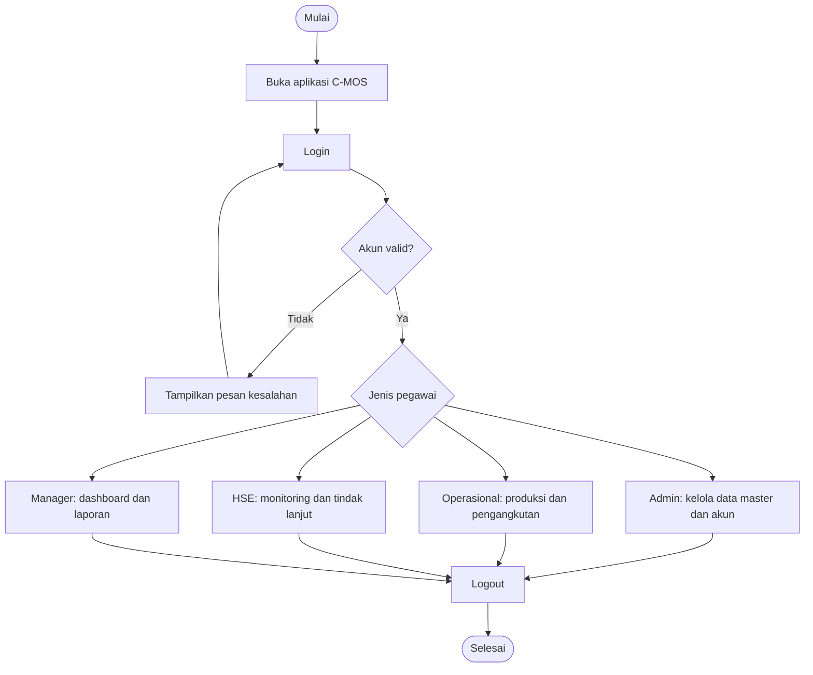
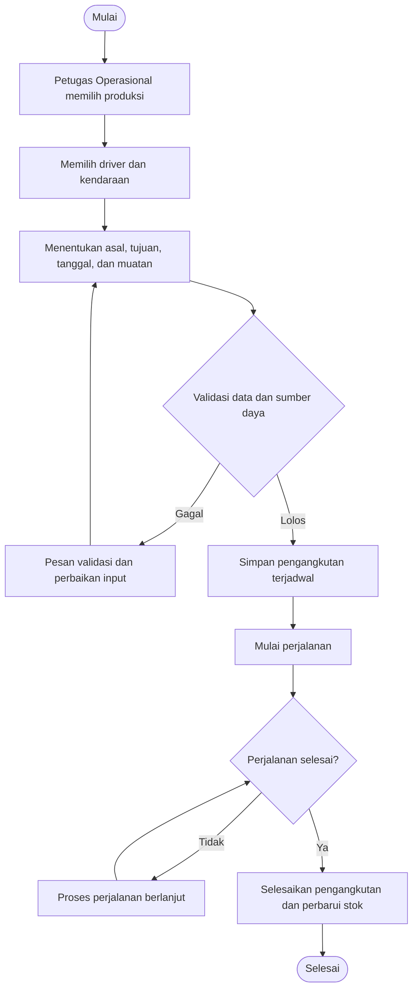
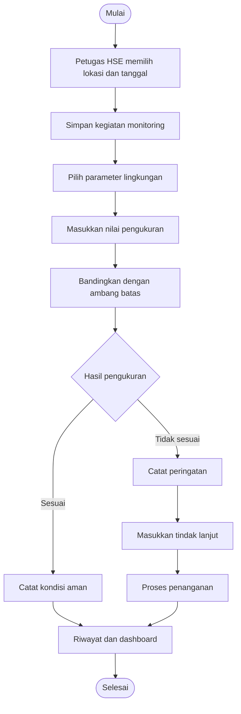
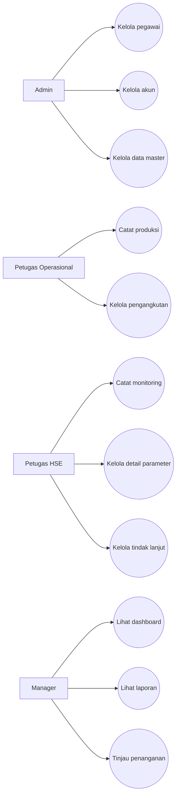

# C-MOS: Cobalt Mining Operation System

> Aplikasi desktop pengelolaan operasional pertambangan PT Cobalt.
>
> Proyek akademik Pemrograman Berorientasi Objek (PBO) dan Sistem Basis Data (SBD).

## Daftar Isi

1. [Nama Program](#1-nama-program)
2. [Deskripsi Singkat](#2-deskripsi-singkat)
3. [Fitur Utama Program](#3-fitur-utama-program)
4. [Tech Stack](#4-tech-stack)
5. [Perancangan Sistem](#5-perancangan-sistem)
6. [Struktur Folder dan Package](#6-struktur-folder-dan-package)
7. [Penerapan Empat Pilar OOP](#7-penerapan-empat-pilar-oop)
8. [Cara Penggunaan Program](#8-cara-penggunaan-program)
9. [Kontributor](#9-kontributor)

---

## 1. Nama Program

**C-MOS (Cobalt Mining Operation System)** adalah aplikasi desktop berbasis Java untuk mengelola kegiatan operasional PT Cobalt. C-MOS menghubungkan data pegawai, akun, lokasi, material, kendaraan, produksi, pengangkutan, pemantauan lingkungan, dan laporan manajemen.

- **Nama aplikasi:** Cobalt Mining Operation System (C-MOS)
- **Studi kasus:** PT Cobalt, perusahaan pertambangan fiktif untuk keperluan akademik.
- **Jenis aplikasi:** Desktop, multi-pengguna berdasarkan jabatan.
- **Proyek NetBeans/Maven:** `CobaltMiningOperationSystem`
- **Entry point:** `app.Main`
- **Fokus:** Produksi tambang, pengangkutan material, pemantauan lingkungan, dan dukungan keputusan manajer.

> **Gambar 1. Identitas dan tampilan awal aplikasi C-MOS**


**Arahan screenshot:** Jalankan aplikasi, ambil tampilan awal atau login yang menampilkan identitas C-MOS. Jangan memakai gambar desain contoh sebagai pengganti hasil program.

## 2. Deskripsi Singkat

PT Cobalt menjalankan aktivitas penambangan, pengangkutan hasil tambang, pengelolaan kendaraan dan driver, serta pemantauan lingkungan. Seluruh aktivitas tersebut menghasilkan data yang saling berhubungan. Pengelolaan terpisah menyulitkan pencarian informasi, pemeriksaan stok material, penjadwalan kendaraan, pemilihan driver, dan evaluasi kondisi lingkungan.

C-MOS dirancang untuk mengintegrasikan proses tersebut dalam satu aplikasi desktop yang terhubung ke MySQL. Petugas Operasional mencatat hasil produksi, lalu menggunakan produksi yang tersedia sebagai sumber pengangkutan. Sebelum membuat pengangkutan, sistem memeriksa kesesuaian lokasi, kapasitas kendaraan, ketersediaan driver, masa berlaku SIM, jumlah material, serta potensi benturan jadwal. Petugas HSE mencatat hasil pengukuran parameter lingkungan dan tindak lanjut. Manager memantau hasil kegiatan melalui dashboard dan laporan.

Data lingkungan menjadi informasi untuk pengambilan keputusan. Status peringatan lingkungan **tidak otomatis menghentikan pengangkutan**. Tindakan operasional tetap mengikuti kewenangan dan proses yang ditentukan perusahaan.

### 2.1 Tujuan pengembangan

1. Memusatkan pencatatan data operasional pertambangan.
2. Menghubungkan produksi dengan pengangkutan berdasarkan sumber material.
3. Mencegah penugasan driver atau kendaraan yang tidak memenuhi ketentuan operasional.
4. Mengontrol jumlah muatan terhadap kapasitas kendaraan dan stok produksi.
5. Mencatat hasil monitoring lingkungan dan tindak lanjutnya.
6. Menyediakan dashboard dan laporan untuk mendukung keputusan Manager.
7. Menerapkan konsep PBO, basis data relasional, dan antarmuka Java Swing.

### 2.2 Ruang lingkup

Sistem mengelola data pegawai, akun, lokasi, jenis material, kendaraan, parameter lingkungan, produksi tambang, pengangkutan, monitoring lingkungan, detail monitoring, dan laporan. Pemeriksaan teknis kendaraan secara terpisah tidak termasuk modul utama. Driver merupakan data pegawai yang ditugaskan dalam pengangkutan, bukan pengguna yang melakukan login.

### 2.3 Pembagian peran

| Peran | Tanggung jawab utama | Login |
| --- | --- | --- |
| Admin | Mengelola pegawai, akun, dan data master | Ya |
| Petugas Operasional | Mengelola produksi dan pengangkutan | Ya |
| Petugas HSE | Mengelola monitoring, pengukuran, dan tindak lanjut lingkungan | Ya |
| Manager | Melihat dashboard, laporan, detail operasional, dan informasi penanganan | Ya |
| Driver | Mengemudikan kendaraan pada kegiatan pengangkutan | Tidak |

**Catatan akses:** Manager tidak bertugas menambah detail pengukuran parameter. Pengisian pengukuran merupakan tanggung jawab Petugas HSE. Hak akses yang benar harus diuji pada hasil program.

## 3. Fitur Utama Program

### 3.1 Autentikasi dan pembagian akses

- Login menggunakan akun pengguna.
- Mengidentifikasi pegawai yang terhubung dengan akun.
- Mengarahkan pengguna ke halaman utama sesuai jenis pegawai.
- Menyediakan empat halaman utama: `MainFrameAdmin`, `MainFrameOperasional`, `MainFrameHSE`, dan `MainFrameManager`.
- Memisahkan data `User` dari `Pegawai`. Driver tidak memiliki akun login.

### 3.2 Pengelolaan pegawai

- Menambah, melihat, mengubah, dan menghapus data sesuai aturan sistem.
- Memilih jenis pegawai: Admin, Petugas Operasional, Petugas HSE, Manager, atau Driver.
- Menampilkan isian khusus sesuai jenis pegawai.
- Mengelola status kepegawaian.
- Menyimpan data turunan sesuai jenis pegawai pada tabel yang bersangkutan.

Contoh isian khusus: `shift_kerja` pada Petugas Operasional, `no_sim` dan `masa_berlaku_sim` pada Driver, `no_sertifikasi_HSE` pada Petugas HSE, serta `divisi_tanggung_jawab` pada Manager.

### 3.3 Pengelolaan akun pengguna

- Membuat dan mengelola akun bagi pegawai yang berhak login.
- Mengaitkan akun dengan satu pegawai.
- Memeriksa identitas saat login.
- Mengelola perubahan data akun sesuai hak akses.

### 3.4 Pengelolaan lokasi

- Menyimpan nama, jenis, status operasional, dan keterangan lokasi.
- Membedakan lokasi penambangan (`PIT`) dan lokasi penumpukan (`STOCKPILE`).
- Menyediakan pilihan lokasi pada produksi, pengangkutan, dan monitoring.

### 3.5 Pengelolaan jenis material

- Menyimpan nama material, satuan, dan deskripsi.
- Menghubungkan jenis material dengan catatan produksi.
- Menyediakan pilihan material dalam form produksi.

### 3.6 Pengelolaan kendaraan

- Menyimpan jenis kendaraan, nomor polisi, kapasitas, tahun, dan status kendaraan.
- Memeriksa ketersediaan kendaraan sebelum pengangkutan.
- Memvalidasi muatan agar tidak melampaui kapasitas.

### 3.7 Pengelolaan parameter lingkungan

- Menyimpan nama parameter, satuan, batas minimum, batas maksimum, dan keterangan.
- Menggunakan parameter sebagai acuan pemeriksaan hasil pengukuran.
- Menghubungkan parameter dengan setiap detail monitoring.

Contoh parameter yang dapat disiapkan dalam data master: pH air, TSS, PM10, kebisingan, dan kadar kobalt dalam air. Nilai batas harus mengikuti ketentuan atau data studi kasus yang digunakan, bukan angka asumsi tanpa dasar.

### 3.8 Produksi tambang

- Mencatat tanggal, lokasi, jenis material, jumlah produksi, dan petugas pencatat.
- Menghitung jumlah material yang tersedia untuk pengangkutan.
- Menyediakan daftar produksi sebagai sumber pengangkutan.
- Menampilkan status produksi dan informasi stok.

### 3.9 Pengangkutan material

- Memilih produksi sebagai sumber material.
- Memilih kendaraan dan driver yang tersedia.
- Menentukan lokasi asal dan tujuan.
- Memvalidasi muatan terhadap kapasitas kendaraan dan stok produksi.
- Memeriksa status pegawai, status driver, masa berlaku SIM, dan jadwal yang berpotensi bentrok.
- Mendukung tahapan pengangkutan: `DIJADWALKAN`, `DALAM_PERJALANAN`, `SELESAI`, dan pembatalan sesuai aturan program.
- Memperbarui stok setelah pengangkutan diselesaikan sesuai logika service.

### 3.10 Monitoring lingkungan

- Mencatat kegiatan monitoring berdasarkan lokasi dan petugas HSE.
- Memasukkan nilai hasil pengukuran untuk setiap parameter.
- Membandingkan hasil pengukuran dengan ambang batas.
- Menampilkan kondisi monitoring, tindak lanjut, dan status penanganan.
- Menyimpan riwayat monitoring serta detail pengukuran.
- Menyediakan informasi kondisi lokasi untuk Manager.

### 3.11 Dashboard dan laporan

- Dashboard khusus untuk setiap jenis pengguna.
- Ringkasan data produksi, pengangkutan, kendaraan, dan lingkungan sesuai kewenangan.
- Grafik ringkasan melalui komponen chart yang tersedia.
- Halaman laporan produksi, pengangkutan, dan monitoring.
- Penyajian data detail agar Manager dapat menilai kondisi operasional.

### 3.12 Pencarian, filter, dan validasi

Aplikasi menyediakan komponen tabel, form, dan filter pada berbagai halaman. Filter harus memuat data dari sumber yang relevan. Data internal seperti ID basis data dapat disembunyikan dari tampilan dan diganti nomor urut baris, tanpa menghilangkan ID yang dibutuhkan program untuk operasi CRUD.

## 4. Tech Stack

| Komponen | Teknologi | Penggunaan |
| --- | --- | --- |
| Bahasa | Java | Logika aplikasi, model, controller, dan antarmuka |
| GUI | Java Swing | JFrame, JPanel, JTable, JComboBox, JButton, dan komponen form |
| GUI Designer | Apache NetBeans GUI Builder | Mendesain dan memelihara antarmuka `.form` |
| Database | MySQL | Menyimpan data relasional |
| Akses database | JDBC | Koneksi dan eksekusi SQL |
| Driver database | MySQL Connector/J 8.3.0 | Penghubung JDBC ke MySQL |
| Build tool | Apache Maven | Dependensi dan build aplikasi |
| Layout | Swing Layout 1.0.3, AbsoluteLayout | Layout yang digunakan pada proyek |
| Pemilih tanggal | JCalendar 1.4 | Komponen tanggal pada form |
| Grafik | JFreeChart 1.5.4 | Grafik dashboard |
| Arsitektur | Model, View, Controller, Service, Repository, DAO | Pemisahan tanggung jawab program |

**Versi Java pada berkas yang diperiksa:** `pom.xml` berisi `<maven.compiler.release>26</maven.compiler.release>`. Oleh karena itu, README ini mengikuti konfigurasi proyek tersebut. Jika target tugas mewajibkan Java 8, konfigurasi dan kompatibilitas kode perlu disesuaikan terlebih dahulu.

**Konfigurasi database pada source:** `config.DatabaseConfig` menggunakan nilai bawaan `jdbc:mysql://localhost:3308/cmos_db`, pengguna `root`, dan kata sandi kosong jika variabel lingkungan tidak diisi. Nama database ini mengikuti source yang diperiksa, bukan asumsi dari diagram.

Variabel lingkungan yang didukung:

```text
CMOS_DB_URL
CMOS_DB_USER
CMOS_DB_PASSWORD
```

### 4.1 Cara menyiapkan proyek

1. Siapkan JDK sesuai versi `pom.xml`.
2. Instal Apache NetBeans yang mendukung proyek Maven dan versi Java tersebut.
3. Siapkan MySQL dan buat/import skema database yang sesuai dengan source proyek.
4. Pastikan alamat, port, nama database, username, dan password benar.
5. Buka folder `CobaltMiningOperationSystem` melalui NetBeans.
6. Jalankan proses pemuatan dependensi Maven.
7. Jalankan kelas utama `app.Main`.
8. Login menggunakan akun yang tersedia dalam database.

> **Gambar 2. Konfigurasi proyek Maven di NetBeans**


**Arahan screenshot:** Buka tab Projects, tampilkan nama proyek, Source Packages, Dependencies, dan file `pom.xml`.

> **Gambar 3. Koneksi database MySQL**


**Arahan screenshot:** Tampilkan daftar tabel database yang benar-benar digunakan. Jangan tampilkan kata sandi atau informasi sensitif.

## 5. Perancangan Sistem

### 5.1 Gambaran alur sistem

Alur utama aplikasi dimulai ketika pengguna membuka program dan login. Sistem memeriksa akun serta jenis pegawai. Setelah berhasil, aplikasi membuka halaman utama sesuai kewenangan pengguna. Setiap kegiatan operasional menggunakan data master yang sudah disimpan sebelumnya.



> **Gambar 4. Flowchart utama sistem C-MOS**


**Arahan gambar:** Buat flowchart final di draw.io, Lucidchart, atau aplikasi diagram lain berdasarkan alur di atas. Simpan hasil ekspor sebagai `images/04_Flowchart_Utama.png`.

### 5.2 Flowchart produksi dan pengangkutan



> **Gambar 5. Flowchart proses produksi dan pengangkutan**


**Arahan gambar:** Gambarkan validasi stok, kapasitas, driver, SIM, kendaraan, lokasi, dan jadwal. Tunjukkan pula jalur pembatalan sesuai aturan service.

### 5.3 Flowchart monitoring lingkungan



> **Gambar 6. Flowchart monitoring lingkungan**


**Arahan gambar:** Tampilkan kegiatan monitoring, pengisian detail parameter, hasil evaluasi, tindak lanjut, dan informasi kepada Manager.

### 5.4 Use case diagram



> **Gambar 7. Use case diagram C-MOS**


**Arahan gambar:** Gunakan aktor Admin, Petugas Operasional, Petugas HSE, dan Manager. Driver tidak perlu menjadi aktor login karena ia tidak mengakses aplikasi. Jika Driver digambar sebagai aktor bisnis, bedakan dari aktor pengguna sistem.

### 5.5 ERD dan struktur basis data

Perancangan basis data menggunakan `Pegawai` sebagai supertype dan lima subtype: `Admin`, `PetugasOperasional`, `PetugasHSE`, `Manager`, dan `Driver`. Tabel `User` menyimpan akun login yang terkait dengan pegawai. Produksi menjadi sumber pengangkutan. Monitoring lingkungan memiliki beberapa detail pengukuran, dan setiap detail merujuk pada satu parameter lingkungan.

> **Gambar 8. Entity Relationship Diagram C-MOS**


**Arahan gambar:** Gunakan screenshot ERD fisik dari MySQL Workbench yang memperlihatkan tabel, PK, FK, serta kardinalitas. Perbesar gambar sampai nama tabel dan atribut terbaca. Pastikan diagram sesuai database aktual yang dijalankan.

> **Gambar 9. Enhanced Entity Relationship Diagram dan subtype Pegawai**


**Arahan gambar:** Gunakan diagram konseptual yang menunjukkan pengelompokan lima subtype di dalam Pegawai, relasi dengan User, serta hubungan ke modul operasional dan monitoring.

#### 5.5.1 Kelompok entitas

| Kelompok | Entitas/tabel | Fungsi |
| --- | --- | --- |
| Kepegawaian | `pegawai` | Identitas dasar pegawai |
| Kepegawaian | `admin` | Atribut khusus Admin |
| Kepegawaian | `petugas_operasional` | Atribut khusus petugas operasional |
| Kepegawaian | `petugas_hse` | Atribut khusus HSE |
| Kepegawaian | `manager` | Atribut khusus Manager |
| Kepegawaian | `driver` | Data SIM dan ketersediaan driver |
| Akses | `user` | Kredensial akun |
| Master | `lokasi` | Lokasi tambang dan stockpile |
| Master | `jenis_material` | Klasifikasi material |
| Master | `kendaraan` | Armada pengangkutan |
| Master | `parameter_lingkungan` | Acuan pengukuran lingkungan |
| Operasional | `produksi_tambang` | Produksi dan material tersedia |
| Operasional | `pengangkutan` | Perjalanan pengangkutan |
| Lingkungan | `monitoring_lingkungan` | Kegiatan monitoring |
| Lingkungan | `detail_monitoring` | Nilai pengukuran per parameter |

#### 5.5.2 Relasi utama

1. `Pegawai` dengan `User`: satu pegawai dapat mempunyai nol atau satu akun.
2. `Pegawai` dengan subtype: setiap subtype memakai identitas pegawai sebagai dasar.
3. `PetugasOperasional` dengan `ProduksiTambang`: satu petugas dapat mencatat banyak produksi.
4. `PetugasOperasional` dengan `Pengangkutan`: satu petugas dapat mengelola banyak pengangkutan.
5. `JenisMaterial` dengan `ProduksiTambang`: satu jenis material digunakan pada banyak produksi.
6. `Lokasi` dengan `ProduksiTambang`: satu lokasi memiliki banyak catatan produksi.
7. `ProduksiTambang` dengan `Pengangkutan`: satu produksi dapat menjadi sumber banyak pengangkutan.
8. `Driver` dengan `Pengangkutan`: satu driver dapat mengemudikan banyak pengangkutan pada waktu berbeda.
9. `Kendaraan` dengan `Pengangkutan`: satu kendaraan dapat digunakan pada banyak perjalanan berbeda.
10. `Lokasi` dengan `Pengangkutan`: lokasi digunakan sebagai asal dan tujuan.
11. `PetugasHSE` dengan `MonitoringLingkungan`: satu petugas HSE dapat melakukan banyak monitoring.
12. `Lokasi` dengan `MonitoringLingkungan`: satu lokasi dapat dipantau berulang kali.
13. `MonitoringLingkungan` dengan `DetailMonitoring`: satu monitoring memiliki banyak hasil parameter.
14. `ParameterLingkungan` dengan `DetailMonitoring`: satu parameter dapat digunakan dalam banyak monitoring.

#### 5.5.3 Contoh keterkaitan data

Misalnya produksi di PIT A menghasilkan 120 ton material. Petugas membuat rencana pengangkutan sebesar 20 ton menggunakan kendaraan berkapasitas 25 ton. Sistem memeriksa bahwa produksi memiliki stok yang mencukupi, kendaraan tersedia, driver tersedia, SIM berlaku, dan lokasi tujuan sesuai. Setelah perjalanan selesai, sistem memperbarui stok produksi sesuai jumlah yang diangkut. Data ini kemudian masuk ke laporan pengangkutan dan ringkasan dashboard.

Pada waktu berbeda, HSE mengukur parameter lingkungan di PIT A. Jika salah satu nilai berada di luar ambang batas, hasil monitoring dapat menunjukkan peringatan. Manager melihat kondisi tersebut sebagai informasi untuk menentukan tindak lanjut, bukan sebagai pemblokiran otomatis oleh aplikasi.

### 5.6 Konsistensi model dengan database

Diagram yang digunakan pada README harus disamakan dengan skema MySQL yang benar-benar diimpor. Gambar konseptual dan fisik dapat memiliki perbedaan cara menampilkan subtype atau nama foreign key. Jangan mengubah penjelasan berdasarkan gambar saja tanpa memeriksa tabel database dan DAO. Pada source yang diperiksa, `jenis_kendaraan` merupakan atribut dalam `kendaraan`, bukan tabel master terpisah.

## 6. Struktur Folder dan Package

Struktur berikut mengikuti source Java pada arsip `CMOS_Revisi_Awal_GUIBuilder.zip` yang tersedia untuk pemeriksaan.

```text
CobaltMiningOperationSystem/
├── pom.xml
├── lib/
├── src/
│   └── main/
│       └── java/
│           ├── app/
│           │   └── Main.java
│           ├── config/
│           │   ├── AppConfig.java
│           │   └── DatabaseConfig.java
│           ├── controller/
│           │   ├── AuthController.java
│           │   ├── DashboardController.java
│           │   ├── LaporanController.java
│           │   ├── MasterDataController.java
│           │   ├── MonitoringController.java
│           │   ├── PengangkutanController.java
│           │   └── ProduksiController.java
│           ├── dao/
│           │   ├── JdbcSupport.java
│           │   ├── KendaraanDAO.java
│           │   ├── LokasiDAO.java
│           │   ├── MaterialDAO.java
│           │   ├── MonitoringDAO.java
│           │   ├── ParameterDAO.java
│           │   ├── PegawaiDAO.java
│           │   ├── PengangkutanDAO.java
│           │   ├── ProduksiDAO.java
│           │   └── UserDAO.java
│           ├── enums/
│           │   ├── JenisLokasi.java
│           │   ├── Periode.java
│           │   ├── ShiftKerja.java
│           │   ├── StatusDetail.java
│           │   ├── StatusDriver.java
│           │   ├── StatusKendaraan.java
│           │   ├── StatusLokasi.java
│           │   ├── StatusMonitoring.java
│           │   ├── StatusPegawai.java
│           │   ├── StatusPenanganan.java
│           │   ├── StatusPengangkutan.java
│           │   └── StatusProduksi.java
│           ├── exception/
│           │   ├── BusinessException.java
│           │   ├── DataNotFoundException.java
│           │   └── ValidationException.java
│           ├── model/
│           │   ├── Pegawai.java
│           │   ├── Admin.java
│           │   ├── PetugasOperasional.java
│           │   ├── PetugasHSE.java
│           │   ├── Manager.java
│           │   ├── Driver.java
│           │   ├── User.java
│           │   ├── Lokasi.java
│           │   ├── JenisMaterial.java
│           │   ├── Kendaraan.java
│           │   ├── ProduksiTambang.java
│           │   ├── Pengangkutan.java
│           │   ├── ParameterLingkungan.java
│           │   ├── MonitoringLingkungan.java
│           │   └── DetailMonitoring.java
│           ├── repository/
│           │   ├── CrudRepository.java
│           │   ├── PegawaiRepository.java
│           │   ├── UserRepository.java
│           │   ├── LokasiRepository.java
│           │   ├── MaterialRepository.java
│           │   ├── KendaraanRepository.java
│           │   ├── ProduksiRepository.java
│           │   ├── PengangkutanRepository.java
│           │   ├── ParameterRepository.java
│           │   └── MonitoringRepository.java
│           ├── service/
│           │   ├── AuthService.java
│           │   ├── MasterDataService.java
│           │   ├── ProduksiService.java
│           │   ├── PengangkutanService.java
│           │   ├── MonitoringService.java
│           │   ├── DashboardService.java
│           │   └── LaporanService.java
│           ├── util/
│           │   ├── BootstrapAdmin.java
│           │   └── PasswordUtil.java
│           └── view/
│               ├── LoginFrame.java
│               ├── MainFrameRouter.java
│               ├── MainFrameAdmin.java
│               ├── MainFrameOperasional.java
│               ├── MainFrameHSE.java
│               ├── MainFrameManager.java
│               ├── DashboardAdminPanel.java
│               ├── DashboardOperasionalPanel.java
│               ├── DashboardHSEPanel.java
│               ├── DashboardManagerPanel.java
│               ├── DashboardCharts.java
│               ├── PegawaiPanel.java
│               ├── PegawaiFormFrame.java
│               ├── UserPanel.java
│               ├── UserFormFrame.java
│               ├── LokasiPanel.java
│               ├── LokasiFormFrame.java
│               ├── MaterialPanel.java
│               ├── MaterialFormFrame.java
│               ├── KendaraanPanel.java
│               ├── KendaraanFormFrame.java
│               ├── ParameterPanel.java
│               ├── ParameterFormFrame.java
│               ├── ProduksiPanel.java
│               ├── ProduksiFormFrame.java
│               ├── PengangkutanPanel.java
│               ├── PengangkutanFormFrame.java
│               ├── MonitoringPanel.java
│               ├── MonitoringFormFrame.java
│               ├── DetailMonitoringFormFrame.java
│               ├── MonitoringDetailFrame.java
│               ├── KondisiLokasiPanel.java
│               ├── KartuLokasiPanel.java
│               ├── LaporanProduksiPanel.java
│               ├── LaporanPengangkutanPanel.java
│               ├── LaporanMonitoringPanel.java
│               ├── UbahAkunFrame.java
│               ├── DataScreen.java
│               ├── FormUtil.java
│               ├── PilihanData.java
│               └── ViewFactory.java
└── ...
```

> **Gambar 10. Struktur Source Packages di NetBeans**


**Arahan screenshot:** Perluas seluruh package pada panel Projects. Jika terlalu panjang, ambil beberapa screenshot dan gabungkan menjadi satu gambar yang tetap terbaca.

### 6.1 Package `app`

`Main.java` merupakan titik masuk aplikasi. Method `main()` memanggil `SwingUtilities.invokeLater()` agar antarmuka Swing dibuat pada Event Dispatch Thread. Setelah menginisialisasi konfigurasi aplikasi, program membuka `LoginFrame`.

### 6.2 Package `config`

- `AppConfig.java` menyiapkan komponen dan dependensi aplikasi.
- `DatabaseConfig.java` mengatur koneksi JDBC ke MySQL serta menyediakan pemeriksaan koneksi.

### 6.3 Package `controller`

Controller menghubungkan aksi pengguna dari tampilan dengan proses di service. `AuthController` menangani autentikasi, `MasterDataController` menangani data master, `ProduksiController` menangani produksi, `PengangkutanController` menangani pengangkutan, `MonitoringController` menangani monitoring, dan controller dashboard/laporan menyiapkan informasi untuk tampilan.

### 6.4 Package `dao`

DAO berisi implementasi akses database melalui JDBC. Setiap DAO berfokus pada kelompok data tertentu. Contohnya `ProduksiDAO` menangani penyimpanan dan pembacaan produksi, sedangkan `PengangkutanDAO` menangani data pengangkutan. `JdbcSupport` menyediakan fungsi pendukung operasi JDBC.

### 6.5 Package `enums`

Enum membatasi nilai status atau kategori ke pilihan yang telah ditentukan. Contohnya `StatusPengangkutan`, `StatusDriver`, `StatusKendaraan`, `StatusMonitoring`, dan `ShiftKerja`. Penggunaan enum mengurangi kesalahan penulisan status pada logika Java.

### 6.6 Package `exception`

- `ValidationException`: kesalahan nilai masukan.
- `DataNotFoundException`: data yang diminta tidak ditemukan.
- `BusinessException`: pelanggaran aturan proses bisnis.

### 6.7 Package `model`

Model merepresentasikan objek utama sistem. `Pegawai` merupakan superclass abstrak bagi lima jenis pegawai. Model lain merepresentasikan lokasi, material, kendaraan, produksi, pengangkutan, monitoring, parameter, dan detail monitoring.

### 6.8 Package `repository`

Repository mendefinisikan operasi data yang diperlukan oleh service. `CrudRepository` menyediakan kontrak operasi umum. Repository khusus memisahkan kebutuhan data per domain, sedangkan DAO menjalankan query JDBC yang sesuai.

### 6.9 Package `service`

Service menyimpan aturan bisnis. Contohnya `PengangkutanService` memeriksa kapasitas, ketersediaan, tanggal, SIM, stok, dan jadwal sebelum membuat pengangkutan. `MonitoringService` menangani kegiatan monitoring, detail pengukuran, dan tindak lanjut. `DashboardService` serta `LaporanService` menyajikan data ringkasan dan laporan.

### 6.10 Package `util`

`BootstrapAdmin` menyediakan proses pendukung inisialisasi admin, sedangkan `PasswordUtil` menyediakan fungsi pendukung pengelolaan kata sandi.

### 6.11 Package `view`

Package `view` menyimpan JFrame dan JPanel antarmuka. Berkas `.form` yang menyertai sejumlah kelas view merupakan metadata desain NetBeans GUI Builder. Desain komponen dan layout harus dikelola melalui tab **Design**, bukan dengan membuat panel visual baru secara manual melalui kode.

`MainFrameRouter` mengarahkan pengguna ke halaman utama berdasarkan jenis pegawai. Setiap `MainFrame...` menyediakan navigasi untuk peran terkait. `...Panel` menyajikan halaman daftar, dashboard, atau laporan. `...FormFrame` menyediakan formulir tambah dan ubah data.

> **Gambar 11. File `.java` dan `.form` pada GUI Builder**


**Arahan screenshot:** Pilih `PegawaiFormFrame` atau form lain di NetBeans. Tampilkan tab Design, Palette, Inspector, dan Properties.

## 7. Penerapan Empat Pilar OOP

### 7.1 Encapsulation

Encapsulation melindungi atribut objek dengan akses `private` dan menyediakan akses terkontrol melalui method. Contohnya pada `model.Pegawai`:

```java
private int idPegawai;
private String namaPegawai;
private String noHp;
private java.time.LocalDate tanggalMasuk;
private enums.StatusPegawai statusPegawai;

public String getNamaPegawai() {
    return namaPegawai;
}

public void setNamaPegawai(String value) {
    this.namaPegawai = value;
}
```

Atribut `namaPegawai` tidak diakses langsung oleh kelas lain. Kelas lain menggunakan getter atau setter. Dengan demikian, struktur data objek tetap terkendali. Validasi bisnis yang lebih kompleks ditempatkan pada service sebelum perubahan data disimpan.

> **Gambar 12. Bukti encapsulation pada `Pegawai.java`**


**Arahan screenshot:** Sorot deklarasi atribut `private` serta method getter dan setter dalam `model/Pegawai.java`.

### 7.2 Inheritance

Inheritance memungkinkan subclass mewarisi atribut dan method dari superclass. Dalam proyek ini, `Pegawai` merupakan superclass bagi `Admin`, `PetugasOperasional`, `PetugasHSE`, `Manager`, dan `Driver`.

```java
public abstract class Pegawai {
    // Atribut dasar pegawai dan method bersama.
}

public class Admin extends Pegawai {
    // Atribut khusus Admin.
}

public class Driver extends Pegawai {
    // Atribut khusus Driver.
}
```

Kode tersebut menunjukkan hubungan pewarisan yang terdapat pada source. Setiap subtype memiliki atribut bersama dari `Pegawai` serta atribut khusus sesuai tugasnya. Contohnya Driver mempunyai informasi SIM, sedangkan Petugas Operasional memiliki informasi shift kerja.

> **Gambar 13. Bukti inheritance pada subclass Pegawai**


**Arahan screenshot:** Buka `Pegawai.java`, `Admin.java`, dan `Driver.java`. Sorot deklarasi `extends Pegawai`. Sertakan diagram hierarki kelas jika memungkinkan.

### 7.3 Polymorphism

Polymorphism memungkinkan objek dari beberapa subclass diperlakukan sebagai tipe superclass yang sama, tetapi memberikan perilaku sesuai jenis objek. Dalam proyek, `Pegawai` mendefinisikan method abstrak `getJenisPegawai()` dan setiap subclass mengimplementasikannya.

```java
public abstract String getJenisPegawai();
```

Contoh pemakaian konsep:

```java
Pegawai pegawai = new Driver(/* parameter konstruktor sesuai model */);
String jenis = pegawai.getJenisPegawai();
```

Baris pemanggilan `getJenisPegawai()` menggunakan tipe referensi `Pegawai`, tetapi implementasi yang dijalankan berasal dari subclass objek aktual. Potongan kedua merupakan **ilustrasi konsep**, bukan salinan kode yang siap dikompilasi karena argumen konstruktor disingkat.

> **Gambar 14. Bukti polymorphism pada `getJenisPegawai()`**


**Arahan screenshot:** Tampilkan deklarasi method di `Pegawai.java` dan implementasi override pada minimal dua subclass, misalnya `Driver.java` dan `PetugasHSE.java`.

### 7.4 Abstraction

Abstraction menyajikan kontrak penting tanpa mewajibkan pemanggil mengetahui seluruh detail implementasi. `Pegawai` ditetapkan sebagai `abstract class`, sehingga objek `Pegawai` umum tidak dapat dibuat secara langsung. Subclass harus menyediakan implementasi `getJenisPegawai()`.

```java
public abstract class Pegawai {
    public abstract String getJenisPegawai();
}
```

Selain itu, `repository.CrudRepository` dan repository khusus menggunakan interface sebagai kontrak akses data. Service dapat bekerja terhadap operasi repository tanpa perlu mengetahui setiap detail SQL di DAO.

> **Gambar 15. Bukti abstraction pada abstract class**


**Arahan screenshot:** Sorot kata `abstract` pada deklarasi `Pegawai` dan method `getJenisPegawai()`.

> **Gambar 16. Bukti abstraction pada interface repository**


**Arahan screenshot:** Buka `repository/CrudRepository.java` dan salah satu repository khusus. Tampilkan kontrak method yang tersedia.

### 7.5 Keterkaitan OOP dengan arsitektur

Penerapan empat pilar OOP tidak berdiri sendiri. Model memanfaatkan encapsulation, inheritance, polymorphism, dan abstraction. Service menggunakan objek model serta kontrak repository untuk menjalankan aturan bisnis. Controller meneruskan permintaan dari view ke service. DAO berkomunikasi dengan database melalui JDBC. Pemisahan ini memudahkan pengujian dan perubahan logika tanpa mencampurkan seluruh proses ke dalam satu JFrame.

> **Gambar 17. Diagram alur arsitektur aplikasi**


**Arahan gambar:** Buat diagram `View → Controller → Service → Repository → DAO → MySQL`, dengan `Model` sebagai objek data yang digunakan antarlapisan. Sesuaikan arah panggilan dengan implementasi aktual.

## 8. Cara Penggunaan Program

Bagian ini mendokumentasikan alur aplikasi dari persiapan, loading, landing, autentikasi, pemilihan hak akses, hingga seluruh proses empat pengguna yang dapat login. Driver merupakan subtype pegawai yang dipilih pada pengangkutan dan tidak memiliki akses login. Setiap tahapan memiliki tempat gambar, penjelasan fungsi, serta arahan pengambilan screenshot. **Gambar wajib berasal dari program yang benar-benar dijalankan.** Apabila tombol atau halaman berbeda pada versi final, gunakan nama aktual dari program dan sesuaikan narasi.

**Urutan dokumentasi:** Persiapan → Loading → Landing → Login → Admin → Logout → Petugas Operasional → Logout → Petugas HSE → Logout → Manager → Logout → Pengujian. Setiap login memakai akun berbeda yang sudah terhubung dengan subtype Pegawai.

### 8.1 Menyiapkan proyek dan basis data

Sebelum pengujian, buka proyek `CobaltMiningOperationSystem` melalui NetBeans. Pastikan MySQL berjalan, skema `cmos_sql` dan data awal tersedia, serta pengaturan JDBC sesuai lingkungan pengujian. Jalankan kelas utama pada package `app`. Jangan tampilkan password database pada dokumentasi.

> **Gambar 18. Proyek C-MOS pada NetBeans**


**Arahan screenshot:** NetBeans menampilkan nama proyek, Source Packages dan struktur package utama.

**Penjelasan:** Bukti bahwa program dibuka sebagai proyek Java dengan package `app`, `dao`, `model`, `repository`, `service`, `util`, dan `view`.

> **Gambar 19. Database C-MOS pada MySQL**


**Arahan screenshot:** Tampilkan nama database dan daftar tabel, tanpa kredensial.

**Penjelasan:** Data pegawai, akun, produksi, pengangkutan, dan monitoring disimpan pada basis data relasional.

> **Gambar 20. Menjalankan aplikasi dari kelas Main**


**Arahan screenshot:** Sorot `app.Main` dan perintah Run.

**Penjelasan:** Kelas utama memulai siklus aplikasi sebelum antarmuka autentikasi digunakan.

### 8.2 Alur loading dan landing

Dokumentasikan halaman pembuka secara berurutan. Loading merupakan tahap awal saat aplikasi menyiapkan tampilan. Landing menjadi pengantar sebelum pengguna menuju login. Karena screenshot source lengkap halaman ini belum tersedia dalam pesan, sesuaikan urutan tombol dan teks dengan output aktual.

> **Gambar 21. Loading awal aplikasi**


**Arahan screenshot:** Jalankan aplikasi dari kondisi tertutup. Ambil layar ketika logo, indikator atau animasi loading muncul.

**Penjelasan:** Menunjukkan proses awal aplikasi sebelum pengguna berinteraksi dengan menu utama.

> **Gambar 22. Loading saat proses berlangsung**


**Arahan screenshot:** Tangkap tampilan indikator progres atau animasi pada waktu berbeda, bila memang tersedia.

**Penjelasan:** Memperlihatkan perubahan visual selama proses pemuatan. Jangan membuat screenshot buatan apabila aplikasi tidak memiliki indikator progres.

> **Gambar 23. Landing page C-MOS**


**Arahan screenshot:** Setelah loading selesai, tangkap keseluruhan landing page, logo, ilustrasi, dan tombol navigasi.

**Penjelasan:** Landing memperkenalkan identitas aplikasi dan mengarahkan pengguna menuju autentikasi.

> **Gambar 24. Tombol masuk dari landing page**


**Arahan screenshot:** Arahkan kursor atau klik tombol masuk, lalu ambil keadaan sebelum halaman berganti.

**Penjelasan:** Menunjukkan jalur navigasi dari halaman pengantar menuju login.

### 8.3 Login dan percabangan empat peran

Halaman login menerima username dan password. Sistem memeriksa akun `User` dan relasinya dengan `Pegawai`. Jenis pegawai menentukan halaman utama yang boleh diakses. Admin, Petugas Operasional, Petugas HSE, dan Manager memiliki alur masing-masing. Driver tidak login.

> **Gambar 25. Form login sebelum diisi**


**Arahan screenshot:** Tampilkan logo, field username dan password, serta tombol login.

**Penjelasan:** Pengguna memulai autentikasi dengan akun yang telah didaftarkan Admin.

> **Gambar 26. Validasi login ketika field kosong**


**Arahan screenshot:** Klik login tanpa mengisi satu atau kedua field, lalu tangkap pesan validasi jika ada.

**Penjelasan:** Menguji bahwa aplikasi tidak menerima input autentikasi yang belum lengkap.

> **Gambar 27. Validasi username atau password salah**


**Arahan screenshot:** Masukkan kredensial pengujian yang salah dan tampilkan pesan penolakan.

**Penjelasan:** Membuktikan sistem menolak akses tidak sah tanpa membuka dashboard.

> **Gambar 28. Percabangan login berdasarkan jabatan**


**Arahan screenshot:** Ambil screenshot diagram alur empat cabang yang dibuat dari alur aplikasi, bukan screenshot dashboard.

**Penjelasan:** Satu form login mengarahkan akun yang valid ke `MainFrameAdmin`, `MainFrameOperasional`, `MainFrameHSE`, atau `MainFrameManager`. Driver tidak termasuk cabang login.

### ALUR A. ADMIN

Admin menyiapkan data induk agar transaksi produksi, pengangkutan, dan monitoring dapat berjalan. Urutan yang disarankan adalah Pegawai → Akun → Lokasi → Material → Kendaraan → Parameter Lingkungan. Setelah data disimpan, periksa tabel, filter, dan form edit.

### 8.4 Login sebagai Admin dan dashboard

Masukkan akun yang terhubung ke subtype Admin. Setelah autentikasi berhasil, pastikan sidebar dan menu menampilkan hak akses Admin, bukan menu transaksi yang khusus untuk petugas lain.

> **Gambar 29. Login menggunakan akun Admin**


**Arahan screenshot:** Isi username Admin dan samarkan password. Ambil screenshot sebelum klik login.

**Penjelasan:** Menunjukkan akun yang dipakai untuk masuk sebagai pengelola data master.

> **Gambar 30. Dashboard utama Admin**


**Arahan screenshot:** Tangkap satu jendela penuh termasuk sidebar, judul, kartu informasi dan menu.

**Penjelasan:** Halaman awal Admin menjadi pusat navigasi pengelolaan data master.

> **Gambar 31. Navigasi menu Admin**


**Arahan screenshot:** Buka atau sorot daftar menu pada sidebar.

**Penjelasan:** Memperlihatkan ruang lingkup pekerjaan Admin dan pemisahan akses antarperan.

### 8.5 Admin mengelola data pegawai

Buka daftar pegawai. Perhatikan data umum pada `Pegawai` dan atribut khusus pada masing-masing subtype. Saat jenis pegawai diganti, isian khusus harus berubah mengikuti pilihan. Status pegawai mengikuti perilaku otomatis pada implementasi akhir.

> **Gambar 32. Tabel daftar pegawai**


**Arahan screenshot:** Tampilkan tabel, tombol Tambah/Ubah/Hapus, pencarian dan filter.

**Penjelasan:** Daftar pegawai memuat seluruh tipe pegawai yang menjadi sumber identitas akun dan penugasan.

> **Gambar 33. Pencarian nama pegawai**


**Arahan screenshot:** Ketik sebagian nama pada kolom pencarian hingga tabel terfilter.

**Penjelasan:** Membuktikan pencarian membantu menemukan pegawai tanpa menelusuri seluruh baris.

> **Gambar 34. Filter jenis pegawai**


**Arahan screenshot:** Pilih salah satu subtype pada ComboBox filter dan tampilkan perubahan tabel.

**Penjelasan:** Filter membatasi data sesuai kategori pegawai.

> **Gambar 35. Form tambah pegawai data umum**


**Arahan screenshot:** Klik Tambah. Tampilkan nama, nomor HP, tanggal masuk, status, dan pilihan jenis pegawai.

**Penjelasan:** Identitas umum disimpan pada entitas induk `Pegawai`.

> **Gambar 36. Form pegawai subtype Admin**


**Arahan screenshot:** Pilih jenis Admin dan tampilkan `kode_admin` serta `tanggal_mulai_akses` jika form aktual memuatnya.

**Penjelasan:** Subtype Admin menyimpan atribut khusus pengelola sistem.

> **Gambar 37. Form pegawai subtype Petugas Operasional**


**Arahan screenshot:** Pilih Petugas Operasional hingga field `shift_kerja` terlihat.

**Penjelasan:** Shift kerja merupakan atribut khusus Petugas Operasional.

> **Gambar 38. Form pegawai subtype Petugas HSE**


**Arahan screenshot:** Pilih Petugas HSE hingga nomor sertifikasi dan masa berlaku sertifikasi terlihat.

**Penjelasan:** Informasi sertifikasi mengidentifikasi petugas yang menangani pemantauan lingkungan.

> **Gambar 39. Form pegawai subtype Manager**


**Arahan screenshot:** Pilih Manager hingga field divisi tanggung jawab terlihat.

**Penjelasan:** Manager memiliki informasi divisi yang menjadi ruang lingkup tanggung jawabnya.

> **Gambar 40. Form pegawai subtype Driver**


**Arahan screenshot:** Pilih Driver hingga nomor SIM, masa berlaku SIM dan status driver terlihat.

**Penjelasan:** Driver terdaftar sebagai pegawai dan dipilih saat pengangkutan, tetapi tidak diberi akun login.

> **Gambar 41. Pegawai berhasil ditambahkan**


**Arahan screenshot:** Simpan satu data uji lalu tangkap baris baru pada tabel.

**Penjelasan:** Menunjukkan proses create dan pembaruan tampilan daftar.

> **Gambar 42. Form ubah data pegawai**


**Arahan screenshot:** Pilih baris lalu klik Ubah. Tampilkan data awal yang telah terisi pada form.

**Penjelasan:** Menunjukkan proses update tanpa membuat pegawai baru.

> **Gambar 43. Tombol Batal pada form pegawai**


**Arahan screenshot:** Buka form lalu klik Batal. Ambil screenshot setelah form ditutup atau kembali ke tabel.

**Penjelasan:** Menguji pembatalan tanpa menyimpan perubahan.

> **Gambar 44. Konfirmasi hapus pegawai**


**Arahan screenshot:** Gunakan data uji yang aman untuk dihapus. Tangkap dialog konfirmasi jika tersedia.

**Penjelasan:** Menjelaskan kontrol penghapusan dan risiko relasi pegawai dengan data lain.

### 8.6 Admin mengelola akun User

Akun dibuat hanya bagi Admin, Petugas Operasional, Petugas HSE, dan Manager. Relasi `User` ke `Pegawai` menentukan hak akses. Driver tetap disimpan pada data pegawai tanpa akun.

> **Gambar 45. Daftar akun pengguna**


**Arahan screenshot:** Tampilkan tabel User beserta tombol pengelolaan.

**Penjelasan:** Akun login dipisahkan dari data identitas pegawai.

> **Gambar 46. Form tambah akun dan pemilihan pegawai**


**Arahan screenshot:** Buka form Tambah dan tampilkan ComboBox pegawai yang bisa memperoleh akun.

**Penjelasan:** Akun dihubungkan ke pegawai tertentu agar sistem mengenali jenis peran.

> **Gambar 47. Akun berhasil dibuat**


**Arahan screenshot:** Simpan akun uji dan tampilkan hasil pada tabel tanpa menampilkan password.

**Penjelasan:** Akun yang aktif dapat digunakan untuk autentikasi sesuai jenis pegawai.

> **Gambar 48. Form ubah akun**


**Arahan screenshot:** Buka aksi Ubah pada satu akun.

**Penjelasan:** Admin dapat memperbarui informasi akun sesuai fungsi yang tersedia.

> **Gambar 49. Pembatasan akun Driver**


**Arahan screenshot:** Tampilkan daftar pilihan pegawai pada form akun untuk membuktikan Driver tidak ditawarkan, jika aturan ini sudah diterapkan.

**Penjelasan:** Driver tidak termasuk empat pengguna yang login ke aplikasi.

### 8.7 Admin mengelola lokasi

Lokasi mencakup area PIT dan STOCKPILE. Data lokasi menjadi referensi pada produksi, pengangkutan, dan monitoring.

> **Gambar 50. Daftar lokasi tambang**


**Arahan screenshot:** Tampilkan tabel, filter dan pencarian lokasi.

**Penjelasan:** Admin memeriksa lokasi operasional yang telah terdaftar.

> **Gambar 51. Form tambah lokasi**


**Arahan screenshot:** Tampilkan nama lokasi, jenis lokasi dan keterangan.

**Penjelasan:** Lokasi baru menjadi pilihan pada transaksi berikutnya.

> **Gambar 52. Status lokasi otomatis**


**Arahan screenshot:** Tampilkan nilai status yang diisi atau ditentukan otomatis sesuai implementasi.

**Penjelasan:** Mendokumentasikan mekanisme penentuan status lokasi.

> **Gambar 53. Ubah dan hapus lokasi**


**Arahan screenshot:** Tampilkan form edit atau dialog hapus data uji.

**Penjelasan:** Membuktikan operasi pengelolaan data lokasi.

### 8.8 Admin mengelola jenis material

Jenis material menyimpan identitas material dan satuan yang digunakan pada pencatatan produksi.

> **Gambar 54. Daftar jenis material**


**Arahan screenshot:** Tampilkan daftar material beserta satuannya.

**Penjelasan:** Jenis material menjadi referensi produksi.

> **Gambar 55. Form tambah jenis material**


**Arahan screenshot:** Tampilkan nama material, satuan dan deskripsi.

**Penjelasan:** Admin mendaftarkan jenis material yang dapat diproduksi.

> **Gambar 56. Ubah dan filter material**


**Arahan screenshot:** Tampilkan form edit atau hasil pencarian.

**Penjelasan:** Mendokumentasikan pemeliharaan data material.

### 8.9 Admin mengelola kendaraan

Kendaraan menyimpan jenis, nomor polisi, kapasitas, tahun, dan status. Status kendaraan harus mengikuti logika otomatis yang diterapkan pada proyek final.

> **Gambar 57. Daftar kendaraan**


**Arahan screenshot:** Tampilkan tabel dengan jenis, nomor polisi, kapasitas dan status.

**Penjelasan:** Kendaraan yang tersedia menjadi sumber daya pengangkutan.

> **Gambar 58. Form tambah kendaraan**


**Arahan screenshot:** Tampilkan seluruh input kendaraan termasuk kapasitas.

**Penjelasan:** Admin menambahkan kendaraan baru ke basis data.

> **Gambar 59. Status kendaraan otomatis**


**Arahan screenshot:** Tampilkan status kendaraan pada form atau tabel setelah simpan.

**Penjelasan:** Status digunakan saat pemilihan kendaraan untuk pengangkutan.

> **Gambar 60. Form ubah kendaraan**


**Arahan screenshot:** Buka kendaraan yang sudah terdaftar dan tampilkan nilai awal.

**Penjelasan:** Admin memperbarui data kendaraan.

> **Gambar 61. Filter kendaraan**


**Arahan screenshot:** Pilih filter jenis atau status dan tampilkan tabel yang berubah.

**Penjelasan:** Filter membantu memilih kendaraan yang memenuhi kebutuhan.

### 8.10 Admin mengelola parameter lingkungan

Parameter lingkungan berisi nama parameter, satuan, ambang minimum, ambang maksimum dan keterangan.

> **Gambar 62. Daftar parameter lingkungan**


**Arahan screenshot:** Tampilkan tabel parameter dan ambang batas.

**Penjelasan:** Parameter menjadi acuan interpretasi hasil pengukuran HSE.

> **Gambar 63. Form tambah parameter lingkungan**


**Arahan screenshot:** Tampilkan input nama, satuan, batas minimum dan maksimum.

**Penjelasan:** Admin mengatur indikator yang akan diukur.

> **Gambar 64. Ubah parameter lingkungan**


**Arahan screenshot:** Buka form edit pada parameter uji.

**Penjelasan:** Perubahan nilai ambang memengaruhi interpretasi pengukuran berikutnya sesuai implementasi.

### 8.11 Admin keluar dari sistem

Setelah seluruh data master siap, gunakan aksi Logout. Halaman login harus kembali tampil sehingga akun petugas berikutnya dapat digunakan.

> **Gambar 65. Logout dari akun Admin**


**Arahan screenshot:** Tampilkan tombol Logout atau dialog konfirmasi, bila ada.

**Penjelasan:** Mengakhiri sesi Admin.

> **Gambar 66. Kembali ke halaman login setelah Admin logout**


**Arahan screenshot:** Tangkap layar login setelah sesi ditutup.

**Penjelasan:** Membuktikan pergantian akun tanpa menjalankan ulang aplikasi.

### ALUR B. PETUGAS OPERASIONAL

Petugas Operasional mencatat hasil produksi dan menjalankan proses pengangkutan. Produksi merupakan sumber material. Pengangkutan harus merujuk produksi, driver, kendaraan, serta lokasi yang relevan. Driver hanya dipilih sebagai penanggung jawab perjalanan.

### 8.12 Login Petugas Operasional dan dashboard

Gunakan akun Petugas Operasional. Periksa bahwa navigasi berfokus pada produksi, pengangkutan, dan informasi pendukung.

> **Gambar 67. Login sebagai Petugas Operasional**


**Arahan screenshot:** Masukkan akun petugas operasional dengan password disamarkan.

**Penjelasan:** Autentikasi menentukan akses ke proses operasional.

> **Gambar 68. Dashboard Petugas Operasional**


**Arahan screenshot:** Tampilkan keseluruhan dashboard dan sidebar.

**Penjelasan:** Petugas melihat ringkasan kegiatan operasional.

> **Gambar 69. Menu dan akses Petugas Operasional**


**Arahan screenshot:** Tampilkan sidebar yang berisi menu sesuai kewenangan.

**Penjelasan:** Memperjelas perbedaan akses dari Admin.

### 8.13 Mencatat dan mengelola produksi tambang

Buka halaman Produksi Tambang. Pilih lokasi produksi, jenis material, tanggal, dan jumlah produksi. Produksi menyimpan total serta jumlah tersedia untuk pengangkutan.

> **Gambar 70. Daftar produksi tambang**


**Arahan screenshot:** Tampilkan tabel produksi dengan tanggal, lokasi, material, total dan jumlah tersedia.

**Penjelasan:** Daftar menjadi sumber informasi stok hasil tambang.

> **Gambar 71. Filter dan pencarian produksi**


**Arahan screenshot:** Gunakan filter lokasi, material, status atau tanggal yang tersedia.

**Penjelasan:** Petugas dapat menelusuri produksi tertentu.

> **Gambar 72. Form tambah produksi**


**Arahan screenshot:** Buka Tambah dan tampilkan seluruh field produksi.

**Penjelasan:** Petugas menyiapkan pencatatan hasil tambang.

> **Gambar 73. ComboBox lokasi dan material pada produksi**


**Arahan screenshot:** Buka pilihan lokasi dan material untuk menunjukkan data master telah dimuat.

**Penjelasan:** Data produksi terhubung ke master lokasi dan jenis material.

> **Gambar 74. Validasi input produksi**


**Arahan screenshot:** Kosongkan field wajib atau masukkan jumlah tidak valid dan tangkap pesan.

**Penjelasan:** Sistem seharusnya menolak produksi yang tidak memenuhi ketentuan input.

> **Gambar 75. Produksi berhasil disimpan**


**Arahan screenshot:** Simpan contoh produksi lalu tampilkan baris baru dan jumlah tersedia.

**Penjelasan:** Jumlah produksi menjadi stok awal yang dapat diangkut.

> **Gambar 76. Form ubah produksi**


**Arahan screenshot:** Pilih produksi uji lalu buka form Ubah jika fitur tersedia.

**Penjelasan:** Perubahan produksi mengikuti aturan yang menjaga konsistensi stok.

> **Gambar 77. Detail produksi tambang**


**Arahan screenshot:** Buka detail atau pilih baris untuk memperlihatkan informasi lengkap.

**Penjelasan:** Petugas dapat memeriksa sumber material sebelum membuat pengangkutan.

### 8.14 Membuat jadwal pengangkutan

Buka halaman Pengangkutan. Pilih produksi yang memiliki material tersedia, driver, kendaraan, waktu perjalanan, serta tujuan. Muatan tidak boleh melampaui kapasitas kendaraan maupun stok produksi. Hubungan Driver hanya menuju Pengangkutan, bukan Produksi.

> **Gambar 78. Daftar kegiatan pengangkutan**


**Arahan screenshot:** Tampilkan tabel, status, waktu, driver dan kendaraan.

**Penjelasan:** Halaman memusatkan catatan perjalanan material.

> **Gambar 79. Filter pengangkutan**


**Arahan screenshot:** Gunakan filter status, periode atau pencarian yang tersedia.

**Penjelasan:** Petugas dapat melihat perjalanan tertentu.

> **Gambar 80. Form tambah pengangkutan**


**Arahan screenshot:** Tampilkan form lengkap dengan produksi, driver, kendaraan, muatan dan tujuan.

**Penjelasan:** Pengangkutan menghubungkan material, pengemudi, armada dan lokasi.

> **Gambar 81. Pilihan produksi sumber pengangkutan**


**Arahan screenshot:** Buka ComboBox produksi dan tunjukkan produksi yang bisa dipilih.

**Penjelasan:** Setiap perjalanan harus memiliki sumber material yang jelas.

> **Gambar 82. Pilihan driver pengangkutan**


**Arahan screenshot:** Buka ComboBox driver yang memuat subtype Driver.

**Penjelasan:** Driver dipilih untuk menjalankan perjalanan tanpa melakukan login.

> **Gambar 83. Pilihan kendaraan pengangkutan**


**Arahan screenshot:** Buka ComboBox kendaraan yang tersedia.

**Penjelasan:** Armada yang dipilih menjadi sumber kapasitas muatan.

> **Gambar 84. Lokasi tujuan pengangkutan**


**Arahan screenshot:** Tampilkan pemilihan tujuan, termasuk STOCKPILE jika sesuai data.

**Penjelasan:** Tujuan mencatat lokasi akhir material.

> **Gambar 85. Validasi kapasitas kendaraan**


**Arahan screenshot:** Masukkan muatan uji lebih besar dari kapasitas lalu tangkap pesan.

**Penjelasan:** Menguji pembatasan muatan berdasarkan kendaraan.

> **Gambar 86. Validasi jumlah material tersedia**


**Arahan screenshot:** Masukkan muatan uji lebih besar dari stok produksi lalu tangkap pesan.

**Penjelasan:** Menguji agar material tidak diangkut melebihi jumlah yang tersedia.

> **Gambar 87. Validasi driver atau kendaraan tidak tersedia**


**Arahan screenshot:** Pilih sumber daya tidak tersedia atau jadwal bentrok, jika validasi tersedia.

**Penjelasan:** Menguji konsistensi penugasan pengemudi dan armada.

> **Gambar 88. Pengangkutan berhasil dijadwalkan**


**Arahan screenshot:** Simpan data valid dan tampilkan status awal pada tabel.

**Penjelasan:** Perjalanan tercatat dan dapat diproses ke tahap berikutnya.

### 8.15 Menjalankan, menyelesaikan, dan memeriksa pengangkutan

Gunakan aksi status yang benar-benar tersedia pada aplikasi. Periksa perubahan waktu mulai, waktu selesai, status perjalanan, dan stok produksi. Dokumentasikan aturan pengurangan stok sesuai perilaku sistem yang diuji, jangan mengasumsikan stok berkurang saat penjadwalan.

> **Gambar 89. Detail pengangkutan terpilih**


**Arahan screenshot:** Pilih baris lalu tampilkan panel detail pengangkutan.

**Penjelasan:** Detail memperlihatkan hubungan produksi, driver, kendaraan, muatan dan tujuan.

> **Gambar 90. Memulai pengangkutan**


**Arahan screenshot:** Klik aksi Mulai atau padanannya dan tangkap status baru.

**Penjelasan:** Menunjukkan perubahan dari jadwal menjadi perjalanan aktif.

> **Gambar 91. Pengangkutan dalam perjalanan**


**Arahan screenshot:** Tampilkan baris perjalanan aktif dan waktu mulai bila tersedia.

**Penjelasan:** Petugas memantau kegiatan yang sedang berjalan.

> **Gambar 92. Menyelesaikan pengangkutan**


**Arahan screenshot:** Klik aksi Selesai dan tangkap perubahan status.

**Penjelasan:** Mencatat penyelesaian kegiatan pengangkutan.

> **Gambar 93. Pengangkutan selesai pada tabel**


**Arahan screenshot:** Tampilkan status selesai beserta waktu selesai jika tersedia.

**Penjelasan:** Riwayat perjalanan dapat ditinjau setelah kegiatan berakhir.

> **Gambar 94. Stok produksi sebelum pengangkutan**


**Arahan screenshot:** Ambil tabel produksi dengan jumlah tersedia sebelum aksi selesai.

**Penjelasan:** Menjadi bukti awal untuk membandingkan stok.

> **Gambar 95. Stok produksi setelah pengangkutan**


**Arahan screenshot:** Ambil tabel produksi yang sama setelah aksi selesai.

**Penjelasan:** Membuktikan pengaruh transaksi pengangkutan terhadap stok berdasarkan implementasi.

> **Gambar 96. Pembatalan atau perubahan pengangkutan**


**Arahan screenshot:** Gunakan data uji dan tampilkan aksi Batal/Ubah bila tersedia.

**Penjelasan:** Menunjukkan cara menangani perjalanan yang tidak dilanjutkan.

> **Gambar 97. Pengangkutan selesai tanpa tombol Muat Ulang**


**Arahan screenshot:** Tampilkan halaman yang sudah memperbarui data tanpa tombol Muat Ulang, jika revisi final sudah diterapkan.

**Penjelasan:** Mendokumentasikan tampilan akhir yang diminta pada rancangan GUI.

### 8.16 Petugas Operasional logout

Setelah seluruh proses produksi dan pengangkutan, keluar dari akun Petugas Operasional.

> **Gambar 98. Logout Petugas Operasional**


**Arahan screenshot:** Tampilkan tombol Logout atau dialog konfirmasi.

**Penjelasan:** Menutup sesi petugas operasional.

> **Gambar 99. Halaman login setelah Operasional logout**


**Arahan screenshot:** Tampilkan layar login kembali.

**Penjelasan:** Menyiapkan pergantian akun ke Petugas HSE.

### ALUR C. PETUGAS HSE

Petugas HSE memantau kondisi lingkungan per lokasi, mencatat monitoring, memasukkan detail parameter, melakukan tindak lanjut, dan melihat riwayat. Halaman Kondisi Lingkungan menjadi pusat pembuatan monitoring dan penanganan. Halaman Riwayat Monitoring difokuskan pada penelusuran serta penghapusan data sesuai hak akses. Status PERINGATAN merupakan informasi untuk pengambilan keputusan, bukan pemblokiran otomatis pengangkutan.

### 8.17 Login HSE dan dashboard

Masuk menggunakan akun Petugas HSE. Periksa menu monitoring dan kondisi lingkungan.

> **Gambar 100. Login menggunakan akun HSE**


**Arahan screenshot:** Masukkan akun HSE dan samarkan password.

**Penjelasan:** Membuktikan login peran HSE.

> **Gambar 101. Dashboard Petugas HSE**


**Arahan screenshot:** Tampilkan seluruh dashboard, sidebar, dan ringkasan.

**Penjelasan:** HSE melihat informasi lingkungan sesuai tugasnya.

> **Gambar 102. Navigasi HSE**


**Arahan screenshot:** Tampilkan menu Kondisi Lingkungan dan Riwayat Monitoring.

**Penjelasan:** Menjelaskan pemisahan proses monitoring aktif dari arsip riwayat.

### 8.18 Memeriksa kondisi lingkungan lokasi

Buka Kondisi Lingkungan. Pilih lokasi untuk melihat status terkini serta detail indikator yang tersedia. Status lokasi dapat NORMAL atau PERINGATAN sesuai hasil monitoring dan aturan yang diterapkan.

> **Gambar 103. Halaman Kondisi Lingkungan**


**Arahan screenshot:** Tampilkan daftar lokasi, pilihan lokasi dan indikator status.

**Penjelasan:** HSE memulai pengawasan berdasarkan lokasi.

> **Gambar 104. Memilih lokasi monitoring**


**Arahan screenshot:** Buka ComboBox lokasi dan pilih satu lokasi uji.

**Penjelasan:** Pilihan lokasi menentukan data kondisi yang ditampilkan.

> **Gambar 105. Status lingkungan lokasi terpilih**


**Arahan screenshot:** Tampilkan status NORMAL atau PERINGATAN untuk lokasi tersebut.

**Penjelasan:** Status merangkum hasil pemantauan dan menjadi informasi operasional.

> **Gambar 106. Detail parameter per lokasi**


**Arahan screenshot:** Tampilkan panel nilai parameter untuk lokasi yang dipilih.

**Penjelasan:** HSE dapat membaca rincian indikator, bukan hanya status umum.

> **Gambar 107. Perbandingan kondisi dua lokasi**


**Arahan screenshot:** Ambil screenshot lokasi kedua yang memiliki data berbeda.

**Penjelasan:** Memperlihatkan bahwa data kondisi mengikuti lokasi yang dipilih.

### 8.19 Membuat kegiatan monitoring

Dari halaman Kondisi Lingkungan, buka form Tambah Monitoring. Pilih lokasi, tanggal menggunakan komponen kalender, lalu isi catatan bila ada. Hubungan monitoring dengan petugas HSE mengikuti akun yang sedang login.

> **Gambar 108. Tombol tambah monitoring pada Kondisi Lingkungan**


**Arahan screenshot:** Tampilkan tombol atau aksi pembuka form dari halaman Kondisi Lingkungan.

**Penjelasan:** Membuktikan pembuatan monitoring berawal dari halaman kondisi.

> **Gambar 109. Form tambah monitoring lingkungan**


**Arahan screenshot:** Tampilkan field lokasi, tanggal, dan catatan.

**Penjelasan:** Mencatat kegiatan pemeriksaan pada satu lokasi.

> **Gambar 110. Kalender tanggal monitoring**


**Arahan screenshot:** Klik ikon kalender sehingga popup pemilihan tanggal terlihat.

**Penjelasan:** Menunjukkan penggunaan `JDateChooser` untuk pemilihan tanggal.

> **Gambar 111. Validasi tanggal monitoring**


**Arahan screenshot:** Coba tanggal tidak valid atau input kosong jika aplikasi menyediakan validasi.

**Penjelasan:** Memeriksa aturan pengisian tanggal.

> **Gambar 112. Monitoring berhasil disimpan**


**Arahan screenshot:** Tampilkan data monitoring baru atau pesan sukses.

**Penjelasan:** Membuktikan pembuatan kegiatan monitoring.

### 8.20 Mengisi detail hasil pengukuran

Setelah kegiatan monitoring dibuat, isi nilai ukur untuk parameter yang tersedia. ERD menunjukkan hubungan `monitoring_lingkungan` → `detail_monitoring` → `parameter_lingkungan`. Bandingkan nilai dengan batas minimum dan maksimum untuk menentukan status detail.

> **Gambar 113. Daftar detail monitoring**


**Arahan screenshot:** Tampilkan daftar parameter yang sudah dicatat pada satu monitoring.

**Penjelasan:** Satu kegiatan dapat memiliki beberapa hasil pengukuran.

> **Gambar 114. Form tambah detail parameter**


**Arahan screenshot:** Buka form yang memuat parameter, nilai ukur, status dan catatan.

**Penjelasan:** HSE mengisi hasil pengukuran secara terstruktur.

> **Gambar 115. ComboBox parameter lingkungan**


**Arahan screenshot:** Buka pilihan parameter yang berasal dari data master.

**Penjelasan:** Memastikan pengukuran memakai indikator yang sudah didefinisikan Admin.

> **Gambar 116. Detail pengukuran kategori aman**


**Arahan screenshot:** Masukkan contoh nilai yang berada dalam ambang dan tampilkan hasilnya.

**Penjelasan:** Menunjukkan interpretasi pengukuran yang memenuhi batas.

> **Gambar 117. Detail pengukuran kategori peringatan**


**Arahan screenshot:** Masukkan contoh nilai di luar ambang dan tampilkan hasilnya.

**Penjelasan:** Menunjukkan identifikasi parameter yang perlu perhatian.

> **Gambar 118. Hasil seluruh parameter monitoring**


**Arahan screenshot:** Tampilkan daftar beberapa parameter dengan nilai, satuan dan status.

**Penjelasan:** Memudahkan pembacaan kondisi lingkungan secara menyeluruh.

> **Gambar 119. Perubahan status lokasi setelah monitoring**


**Arahan screenshot:** Kembali ke Kondisi Lingkungan dan tampilkan status terbaru.

**Penjelasan:** Menjelaskan hubungan hasil detail monitoring dengan ringkasan status lokasi.

### 8.21 Melakukan tindak lanjut dan penanganan

Pada monitoring yang membutuhkan perhatian, buka aksi tindak lanjut dari halaman Kondisi Lingkungan. Isi tindakan, status penanganan dan catatan sesuai field yang tersedia. Data ini menjadi bahan tinjauan Manager.

> **Gambar 120. Form tindak lanjut monitoring**


**Arahan screenshot:** Tampilkan input tindak lanjut pada monitoring berstatus peringatan.

**Penjelasan:** HSE mendokumentasikan rencana atau tindakan perbaikan.

> **Gambar 121. Status penanganan monitoring**


**Arahan screenshot:** Tampilkan pilihan atau tampilan status penanganan.

**Penjelasan:** Memisahkan kondisi lingkungan dari progres penanganannya.

> **Gambar 122. Memperbarui tindak lanjut**


**Arahan screenshot:** Buka kembali data penanganan dan tampilkan perubahan catatan/status.

**Penjelasan:** Mendokumentasikan perkembangan tindakan.

> **Gambar 123. Penanganan monitoring selesai**


**Arahan screenshot:** Tampilkan hasil penyelesaian tindakan jika fitur tersedia.

**Penjelasan:** Memberi informasi bahwa penanganan telah ditindaklanjuti.

> **Gambar 124. Informasi penanganan untuk Manager**


**Arahan screenshot:** Tampilkan data tindak lanjut yang nantinya terlihat pada akun Manager.

**Penjelasan:** Menghubungkan pekerjaan HSE dengan kebutuhan pengawasan manajemen.

### 8.22 Meninjau riwayat monitoring

Halaman Riwayat Monitoring berfungsi untuk menampilkan riwayat dan penghapusan kegiatan monitoring sesuai keputusan rancangan. Pembuatan monitoring, pengisian detail dan penanganan dilakukan melalui Kondisi Lingkungan, bukan dari halaman riwayat.

> **Gambar 125. Halaman Riwayat Monitoring**


**Arahan screenshot:** Tampilkan tabel riwayat, tanggal, lokasi dan status.

**Penjelasan:** HSE dapat menelusuri monitoring yang telah dibuat.

> **Gambar 126. Filter dan pencarian riwayat**


**Arahan screenshot:** Pilih lokasi atau periode pada filter jika tersedia.

**Penjelasan:** Mempersempit data monitoring yang ditampilkan.

> **Gambar 127. Detail riwayat monitoring**


**Arahan screenshot:** Pilih salah satu baris dan tampilkan nilai parameter serta catatan.

**Penjelasan:** Riwayat menyimpan bukti pengukuran terdahulu.

> **Gambar 128. Konfirmasi hapus riwayat monitoring**


**Arahan screenshot:** Gunakan data uji dan tampilkan dialog penghapusan jika ada.

**Penjelasan:** Menunjukkan mekanisme penghapusan kegiatan monitoring.

> **Gambar 129. Riwayat tanpa tombol tambah dan ubah**


**Arahan screenshot:** Tampilkan halaman final yang tidak menyediakan tombol Tambah/Ubah monitoring jika revisi sudah diterapkan.

**Penjelasan:** Memastikan pembagian fungsi antara Kondisi Lingkungan dan Riwayat Monitoring.

### 8.23 Petugas HSE logout

Setelah mencatat monitoring dan tindak lanjut, akhiri sesi HSE.

> **Gambar 130. Logout Petugas HSE**


**Arahan screenshot:** Tampilkan aksi logout.

**Penjelasan:** Mengakhiri sesi pemantauan lingkungan.

> **Gambar 131. Halaman login setelah HSE logout**


**Arahan screenshot:** Tampilkan halaman login setelah logout.

**Penjelasan:** Menyiapkan autentikasi Manager.

### ALUR D. MANAGER

Manager meninjau data yang dibuat Admin, Petugas Operasional, dan Petugas HSE. Fokus utamanya adalah dashboard, laporan produksi, laporan pengangkutan, kondisi lingkungan, dan tindak lanjut. Manager tidak menginput detail pengukuran HSE atau mencatat transaksi operasional melalui akses baca yang dibatasi.

### 8.24 Login Manager dan dashboard

Masuk dengan akun Manager dan amati dashboard. Periksa kesesuaian data ringkasan dengan data yang telah dimasukkan pada tiga alur sebelumnya.

> **Gambar 132. Login menggunakan akun Manager**


**Arahan screenshot:** Isi username Manager dengan password disamarkan.

**Penjelasan:** Mengakses aplikasi sebagai pihak pengambil keputusan.

> **Gambar 133. Dashboard utama Manager**


**Arahan screenshot:** Tampilkan keseluruhan dashboard, kartu statistik dan grafik yang tersedia.

**Penjelasan:** Menyajikan ringkasan kegiatan pertambangan.

> **Gambar 134. Navigasi dan hak akses Manager**


**Arahan screenshot:** Tampilkan sidebar Manager.

**Penjelasan:** Memperlihatkan menu laporan dan pemantauan tanpa pengelolaan master.

> **Gambar 135. Ringkasan produksi pada dashboard**


**Arahan screenshot:** Fokuskan area total produksi dan stok jika tersedia.

**Penjelasan:** Manager mengetahui hasil penambangan dan material yang masih tersedia.

> **Gambar 136. Ringkasan pengangkutan pada dashboard**


**Arahan screenshot:** Fokuskan jumlah atau status perjalanan.

**Penjelasan:** Manager memantau distribusi hasil tambang.

> **Gambar 137. Ringkasan kondisi lingkungan pada dashboard**


**Arahan screenshot:** Fokuskan indikator NORMAL/PERINGATAN dan jumlah lokasi.

**Penjelasan:** Manager mengenali lokasi yang memerlukan perhatian.

### 8.25 Meninjau laporan produksi

Buka laporan produksi dan gunakan filter yang tersedia. Bandingkan total, jumlah tersedia, jenis material dan lokasi dengan transaksi yang telah dibuat Petugas Operasional.

> **Gambar 138. Halaman laporan produksi**


**Arahan screenshot:** Tampilkan tabel, total dan periode.

**Penjelasan:** Laporan menyajikan rekap hasil penambangan.

> **Gambar 139. Filter laporan produksi**


**Arahan screenshot:** Terapkan filter periode, lokasi atau material yang tersedia.

**Penjelasan:** Manager dapat menganalisis subset data produksi.

> **Gambar 140. Detail hasil laporan produksi**


**Arahan screenshot:** Pilih satu data atau bagian ringkasan untuk melihat rincian.

**Penjelasan:** Memudahkan penelusuran asal angka laporan.

### 8.26 Meninjau laporan pengangkutan

Buka laporan pengangkutan dan periksa jumlah muatan, driver, kendaraan, lokasi serta status perjalanan.

> **Gambar 141. Halaman laporan pengangkutan**


**Arahan screenshot:** Tampilkan daftar perjalanan dan ringkasannya.

**Penjelasan:** Manager melihat realisasi pengiriman material.

> **Gambar 142. Filter laporan pengangkutan**


**Arahan screenshot:** Gunakan filter status atau periode yang tersedia.

**Penjelasan:** Membedakan perjalanan terjadwal, berjalan dan selesai.

> **Gambar 143. Detail pengangkutan dalam laporan**


**Arahan screenshot:** Buka detail satu perjalanan.

**Penjelasan:** Manager menelusuri produksi sumber, kendaraan, driver, muatan dan tujuan.

### 8.27 Meninjau laporan dan kondisi lingkungan

Buka laporan monitoring atau menu kondisi lingkungan pada Manager. Periksa status lokasi, hasil parameter dan tindak lanjut HSE. Informasi peringatan digunakan sebagai bahan keputusan, tidak secara otomatis memblokir pengangkutan.

> **Gambar 144. Halaman laporan monitoring Manager**


**Arahan screenshot:** Tampilkan ringkasan hasil monitoring per lokasi.

**Penjelasan:** Manager mengamati kondisi lingkungan dari laporan HSE.

> **Gambar 145. Filter monitoring berdasarkan lokasi**


**Arahan screenshot:** Pilih lokasi yang memiliki monitoring.

**Penjelasan:** Manager dapat memusatkan perhatian pada lokasi tertentu.

> **Gambar 146. Detail nilai parameter pada Manager**


**Arahan screenshot:** Buka rincian parameter dan ambang batas.

**Penjelasan:** Memberikan dasar penilaian terhadap status NORMAL/PERINGATAN.

> **Gambar 147. Detail tindak lanjut HSE pada Manager**


**Arahan screenshot:** Tampilkan catatan dan status penanganan.

**Penjelasan:** Manager mengetahui langkah yang sudah dicatat petugas HSE.

> **Gambar 148. Pembatasan hak ubah data HSE pada Manager**


**Arahan screenshot:** Tampilkan halaman Manager tanpa tombol input nilai ukur, jika akses memang dibatasi.

**Penjelasan:** Membuktikan pemisahan tanggung jawab antarperan.

### 8.28 Manager logout dan akhir penggunaan

Setelah meninjau seluruh laporan, keluar dari akun Manager. Pengguna dapat menutup aplikasi dari halaman login atau tombol keluar sesuai implementasi.

> **Gambar 149. Logout Manager**


**Arahan screenshot:** Tampilkan aksi logout dari dashboard Manager.

**Penjelasan:** Menutup sesi manajemen.

> **Gambar 150. Halaman login setelah Manager logout**


**Arahan screenshot:** Tangkap halaman login tanpa akun aktif.

**Penjelasan:** Menunjukkan aplikasi kembali ke kondisi autentikasi.

> **Gambar 151. Menutup aplikasi C-MOS**


**Arahan screenshot:** Tampilkan aksi keluar atau kondisi jendela tertutup jika memungkinkan.

**Penjelasan:** Menandai akhir alur penggunaan aplikasi.

### 8.29 Pengujian lintas peran dan konsistensi data

Uji hubungan data antarmodul agar dokumentasi tidak hanya menunjukkan halaman. Data master Admin harus tersedia pada form Operasional dan HSE. Data transaksi Operasional dan HSE harus terlihat pada dashboard atau laporan Manager.

> **Gambar 152. Data master Admin muncul pada form produksi**


**Arahan screenshot:** Bandingkan pilihan lokasi/material di form produksi dengan master Admin.

**Penjelasan:** Membuktikan integrasi data master ke transaksi.

> **Gambar 153. Data Driver Admin muncul pada pengangkutan**


**Arahan screenshot:** Tampilkan pilihan driver yang sebelumnya dibuat Admin.

**Penjelasan:** Membuktikan subtype Driver digunakan tanpa login.

> **Gambar 154. Data produksi menjadi sumber pengangkutan**


**Arahan screenshot:** Tampilkan produksi terpilih dalam form pengangkutan.

**Penjelasan:** Membuktikan relasi produksi dan perjalanan.

> **Gambar 155. Hasil pengangkutan terlihat pada laporan Manager**


**Arahan screenshot:** Tampilkan perjalanan selesai yang sama pada laporan Manager.

**Penjelasan:** Membuktikan alur Operasional ke Manager.

> **Gambar 156. Hasil monitoring HSE terlihat pada Manager**


**Arahan screenshot:** Tampilkan monitoring dan status yang sama di kedua akun.

**Penjelasan:** Membuktikan alur HSE ke Manager.

> **Gambar 157. Uji pencarian dan filter tabel**


**Arahan screenshot:** Ambil satu contoh filter yang benar-benar mengubah hasil tabel.

**Penjelasan:** Memastikan kontrol pencarian dan filter berfungsi.

> **Gambar 158. Uji tombol Batal pada form**


**Arahan screenshot:** Buka form Tambah/Ubah, klik Batal, lalu tampilkan kembali halaman daftar.

**Penjelasan:** Menguji pembatalan tanpa perubahan data.

> **Gambar 159. Uji tampilan tabel tanpa kolom ID internal**


**Arahan screenshot:** Tampilkan tabel final yang memakai nomor urut atau kolom bisnis, jika revisi diterapkan.

**Penjelasan:** Mendokumentasikan kerapian presentasi data.

> **Gambar 160. Bukti GUI Builder NetBeans**


**Arahan screenshot:** Tampilkan tab Design dan berkas `.form` dari salah satu JFrame.

**Penjelasan:** Membuktikan desain form dibuat dengan NetBeans GUI Builder.

> **Gambar 161. Bukti GUI Builder untuk landing page**


**Arahan screenshot:** Tampilkan tab Design LandingFrame dan hasil runtime secara berdampingan dalam satu dokumentasi bila diperlukan.

**Penjelasan:** Memeriksa kesesuaian layout yang dirancang dengan tampilan aplikasi.

### 8.30 Panduan pengambilan dan penyimpanan screenshot

1. Buat folder `images` sejajar dengan `README.md`.
2. Jalankan program dan ambil screenshot sesuai urutan gambar pada bagian ini.
3. Gunakan nama file PNG persis seperti yang tercantum di setiap referensi gambar.
4. Untuk halaman, ambil satu jendela penuh agar judul, sidebar, tombol dan tabel terbaca. Untuk form, pastikan seluruh input dan tombol terlihat.
5. Untuk ComboBox, ambil gambar saat daftar pilihan terbuka. Untuk validasi, tampilkan pesan error dan konteks input.
6. Untuk perubahan status atau stok, gunakan data uji yang sama sebelum dan sesudah aksi.
7. Jangan menampilkan password, token, atau kredensial database.
8. Semua gambar dalam README merupakan **slot dokumentasi**, bukan klaim bahwa screenshot sudah diambil atau fitur telah lulus pengujian. Jika fitur belum tersedia, perbaiki aplikasi atau beri keterangan kondisi aktual sebelum publikasi.


### 8.31 Ringkasan alur berdasarkan aktor

| Aktor | Titik masuk | Proses inti | Hasil |
| --- | --- | --- | --- |
| Admin | Login → Dashboard Admin | Pegawai, User, Lokasi, Material, Kendaraan, Parameter | Data master siap dipakai |
| Petugas Operasional | Login → Dashboard Operasional | Produksi → Jadwal Pengangkutan → Perjalanan → Selesai | Data produksi, perjalanan, dan stok |
| Petugas HSE | Login → Dashboard HSE | Kondisi Lokasi → Monitoring → Detail Parameter → Tindak Lanjut → Riwayat | Data kondisi dan penanganan lingkungan |
| Manager | Login → Dashboard Manager | Ringkasan → Laporan Produksi → Pengangkutan → Monitoring | Informasi evaluasi dan keputusan |
| Driver | Tidak login | Dipilih pada form pengangkutan | Penanggung jawab perjalanan |


**Total bukti alur GUI:** 144 gambar, dimulai dari Gambar 18 hingga Gambar 161. Semua gambar menggunakan format caption dan path yang diminta.


## 9. Kontributor

Proyek C-MOS dikembangkan sebagai tugas kelompok. Isi nama dan NIM seluruh anggota sesuai identitas tim yang benar.

| No. | Nama | NIM | Peran |
| --- | --- | --- | --- |
| 1 | Zefri Al Rizqullah | 2509116084 | Anggota tim |
| 2 | **[Nama anggota 2]** | **[NIM anggota 2]** | Anggota tim |
| 3 | **[Nama anggota 3]** | **[NIM anggota 3]** | Anggota tim |
| 4 | **[Nama anggota 4, jika ada]** | **[NIM anggota 4]** | Anggota tim |

> **Gambar 162. Dokumentasi tim pengembang, opsional**


**Arahan gambar:** Tambahkan dokumentasi tim atau identitas kelompok jika diminta dosen. Hapus baris anggota yang tidak digunakan.

---

## Lampiran A. Daftar gambar yang harus disiapkan

README ini menyediakan referensi Gambar 1 sampai Gambar 162. Gambar 1–17 merupakan ilustrasi, perancangan sistem, dan bukti source code. Gambar 18–161 mendokumentasikan alur aplikasi secara berurutan dari persiapan, loading, landing, login, empat peran, hingga pengujian lintas peran. Gambar 162 bersifat opsional untuk dokumentasi tim. Simpan seluruh PNG di folder `images/` menggunakan nama persis sesuai referensi masing-masing gambar.

## Lampiran B. Hal yang harus disesuaikan sebelum publikasi

- Lengkapi nama dan NIM seluruh anggota kelompok.
- Masukkan seluruh screenshot dan diagram yang masih berupa referensi gambar.
- Pastikan ERD sesuai dengan database aktual dan nama foreign key pada DAO.
- Periksa apakah halaman loading/landing benar-benar ada pada versi final.
- Pastikan seluruh fungsi yang didokumentasikan telah diuji dan berjalan.
- Sesuaikan versi Java jika proyek final berbeda dari `pom.xml` yang diperiksa.
- Gunakan database dan port yang sesuai dengan lingkungan komputer pengguna.

---

**C-MOS | Cobalt Mining Operation System**
